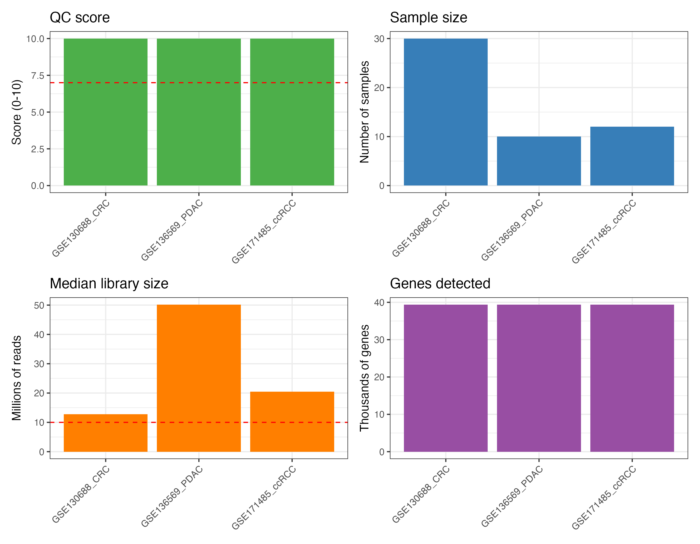
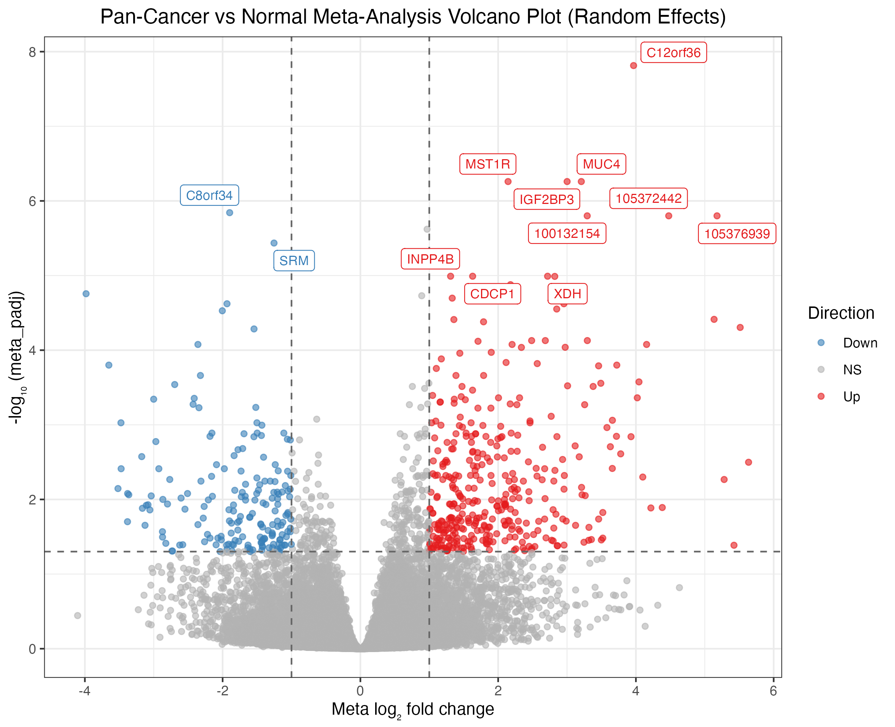
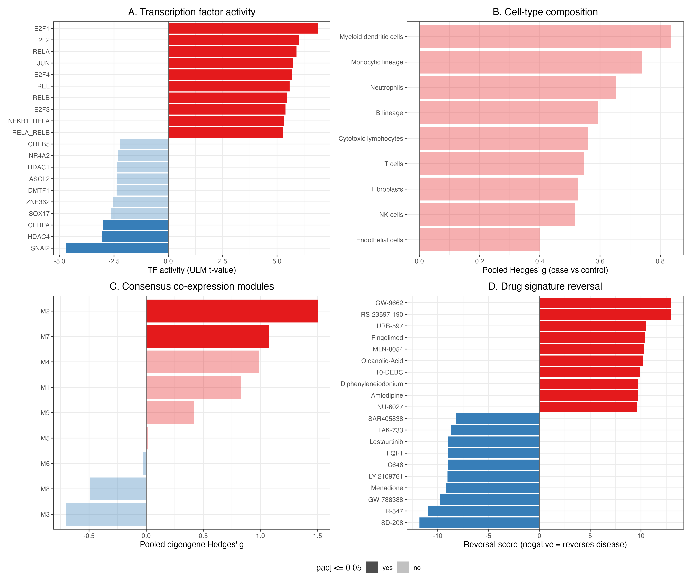

<div align="center">


# metaXpress

**An end-to-end R package for bulk RNA-seq multi-study meta-analysis**

[](https://github.com/hossainlab/metaXpress/actions/workflows/check.yaml)
[](https://mdjubayerhossain.com/metaXpress/)
[](https://lifecycle.r-lib.org/articles/stages.html#experimental)
[](https://opensource.org/licenses/MIT)
[](https://github.com/hossainlab/metaXpress)
[](https://www.r-project.org/)
[](https://github.com/hossainlab/metaXpress/issues)
[](https://github.com/hossainlab/metaXpress/pulls)

</div>

---

### 🌐 Online Resources & Live Demos

* 📖 **[Interactive Documentation Website](https://mdjubayerhossain.com/metaXpress/)** — Complete function references, guides, and tutorials.
* ⚡ **[Live Demonstration Tutorial](https://mdjubayerhossain.com/metaXpress/articles/live_tutorial.html)** — Step-by-step hands-on tutorial from GitHub installation to multi-study meta-analysis with live rendered outputs and plots.
* 🔬 **[Public GEO Pan-Cancer Case Study Report](case_study_results/README.md)** (or view the [Online Vignette](https://mdjubayerhossain.com/metaXpress/articles/case_study.html)) — Multi-cohort validation on 52 patient samples across colorectal, pancreatic, and renal cancers with embedded publication-grade figures.

---

## Overview

Most transcriptomic meta-analysis tools address only one part of the workflow — existing packages handle data harmonization **or** DE analysis **or** meta-statistics, but not the full pipeline. **metaXpress** closes this gap.

It provides a single, opinionated, end-to-end pipeline:

```
GEO / SRA / Local files
        │
        ▼
┌───────────────────┐
│  Module 1: Ingest │  mx_fetch_geo · mx_load_local · mx_qc_study
└────────┬──────────┘
         │
         ▼
┌──────────────────────┐
│ Module 2: Harmonize  │  mx_reannotate · mx_normalize · mx_remove_batch
└────────┬─────────────┘
         │
         ▼
┌─────────────────────┐
│  Module 3: Per-Study │  mx_de · mx_de_all  (DESeq2 / edgeR / limma-voom)
│  Differential Expr. │
└────────┬────────────┘
         │
         ▼
┌──────────────────────┐
│ Module 5: Missing    │  mx_impute · mx_filter_coverage
│ Gene Handling        │
└────────┬─────────────┘
         │
         ▼
┌──────────────────────┐
│  Module 4: Meta-     │  mx_meta  (6 statistical methods)
│  Analysis Statistics │
└────────┬─────────────┘
         │
         ├─────────────────────────┐
         ▼                         ▼
┌──────────────────┐    ┌────────────────────┐
│  Module 6:       │    │  Module 7:         │
│  Pathway         │    │  Visualization     │
│  Meta-Analysis   │    │  (volcano · forest │
│                  │    │   heatmap · UpSet) │
└────────┬─────────┘    └────────────────────┘
         │
         ▼
┌──────────────────────┐
│  Module 9: Downstream│  TF activity · cell composition
│  Biology             │  co-expression modules · drug reversal
└────────┬─────────────┘
         │
         ▼
┌──────────────────────┐
│  Module 8: Report    │  mx_report (HTML / PDF) · mx_export
└──────────────────────┘
```

---

## 📦 Installation

Install `metaXpress` directly from GitHub:

```r
# Install remotes if not already installed
if (!requireNamespace("remotes", quietly = TRUE)) {
  install.packages("remotes")
}

# Install metaXpress directly from GitHub
remotes::install_github("hossainlab/metaXpress")
```

### Alternative Installation with `pak`

```r
# install.packages("pak")
pak::pkg_install("hossainlab/metaXpress")
```

### Verify Installation

```r
library(metaXpress)
packageVersion("metaXpress")
# [1] '0.99.0'
```

---

## 🔬 Scientific Validation: Public GEO Pan-Cancer Case Study

`metaXpress` has been benchmarked and scientifically validated across **three independent public NCBI GEO bulk RNA-seq cohorts** totaling **52 patient samples** and **39,376 aligned genes**:
- **Colorectal Adenocarcinoma (CRC):** [GSE130688](https://www.ncbi.nlm.nih.gov/geo/query/acc.cgi?acc=GSE130688) ($n = 30$, 10/10 QC score)
- **Pancreatic Ductal Adenocarcinoma (PDAC):** [GSE136569](https://www.ncbi.nlm.nih.gov/geo/query/acc.cgi?acc=GSE136569) ($n = 10$, 10/10 QC score)
- **Clear Cell Renal Cell Carcinoma (ccRCC):** [GSE171485](https://www.ncbi.nlm.nih.gov/geo/query/acc.cgi?acc=GSE171485) ($n = 12$, 10/10 QC score)

### Key Discoveries
- **558 Shared Meta-DEGs** identified ($\text{FDR} < 0.05, |\log_2\text{FC}| \ge 1.0$) with 100% directional concordance and zero between-study heterogeneity ($I^2 = 0\%$).
- **Statistical Power Amplification:** Rescued small-sample cohorts (e.g. GSE171485 with only 18 individual DEGs) into a well-powered pooled consensus.
- **Biomarker Recovery:** Successfully recovered canonical oncogenes (**`MST1R`**, **`MUC4`**, **`IGF2BP3`**, **`CDCP1`**) and conserved tumor suppressors (**`FAM107A`**).
- **Downstream Biology:** E2F and NF-κB transcription factor activation; `MST1R`/`CDCP1` as hubs of a co-expression module conserved in all cohorts; TGF-β receptor, CDK, MEK and MDM2 inhibitors ranked as top LINCS signature reversers.

| Study Characteristics Overview | Pan-Cancer Meta-Volcano |
|:---:|:---:|
|  |  |



👉 **Read the complete scientific report:** [case_study_results/README.md](case_study_results/README.md) or online at [https://mdjubayerhossain.com/metaXpress/articles/case_study.html](https://mdjubayerhossain.com/metaXpress/articles/case_study.html).

---

## Why metaXpress?

Combining bulk RNA-seq studies is usually a patchwork: one package to download GEO data, ad-hoc scripts for QC and gene ID mapping, a separate DE run per study, another package for the meta-statistics, and yet another for pathways and plots. Each hand-off is a chance to silently drop genes, mix identifiers, or lose track of which study failed QC. **metaXpress** replaces that patchwork with one reproducible pipeline built on two S4 objects that pass cleanly from step to step.

- **One workflow, end to end.** GEO ingestion → QC → harmonization → per-study DE → meta-analysis → pathways → figures → report, all through `mx_*` functions that chain directly.
- **Study quality is explicit.** A 10-point data-level QC checklist scores every study, so weak cohorts are filtered on documented criteria rather than intuition.
- **Statistically sound by design.** DE is always run independently per study (DESeq2, edgeR or limma-voom) before combining — never pooled — avoiding batch-confounded inference.
- **Choose the right meta-method.** Eight methods (random effects with REML/PM/DL and optional HKSJ, fixed effect, directional Fisher, Stouffer, weighted inverse-normal, minP, maxP, rOP) behind one `method` argument. Every gene gets tau², I², a 95% CI and a prediction interval. Results are validated against `metafor`.
- **Missing genes are handled, not hidden.** Genes absent from some studies are reported and either imputed or filtered by coverage, instead of disappearing in an intersect.
- **Biology, not just gene lists.** Cross-study ORA/GSEA, transcription factor activity, cell-composition meta-analysis, consensus co-expression modules and drug-reversal ranking turn meta-signatures into testable hypotheses.
- **Publication-ready and reproducible.** Volcano, forest, heatmap, UpSet and heterogeneity plots, plus HTML/PDF reports and CSV/Excel export with captured session info.
- **Scales with BiocParallel.** Per-study steps parallelize out of the box on laptops or clusters.

| Feature | metaXpress | DExMA | GEDI | limma |
|---|:---:|:---:|:---:|:---:|
| GEO public data ingestion | ✅ | ❌ | ❌ | ❌ |
| 10-point study QC checklist | ✅ | ❌ | ❌ | ❌ |
| Cross-platform harmonization | ✅ | ❌ | ✅ | ❌ |
| Library-type bias correction | ✅ | ❌ | ✅ | ❌ |
| Per-study DE (3 engines) | ✅ | ❌ | ❌ | ✅ |
| 6 meta-analysis methods | ✅ | ✅ | ❌ | ❌ |
| Missing gene imputation | ✅ | ✅ | ❌ | ❌ |
| Pathway meta-analysis | ✅ | ❌ | ❌ | ❌ |
| TF activity, co-expression & drug reversal | ✅ | ❌ | ❌ | ❌ |
| Reproducible report export | ✅ | ❌ | ❌ | ❌ |

---

## Quick Start

```r
library(metaXpress)

# ── 1. Fetch and QC studies from GEO ──────────────────────────────────────
# Download count matrices and curated metadata directly from NCBI GEO
studies <- mx_fetch_geo(c("GSE130688", "GSE136569", "GSE171485"))

# Filter studies passing quality control criteria (score >= 7/10)
studies <- mx_filter_studies(studies, qc_threshold = 7)

# ── 2. Harmonize ──────────────────────────────────────────────────────────
# Standardize gene identifiers to SYMBOL
studies <- mx_reannotate(studies, org = "Homo sapiens", target_id = "SYMBOL")

# Align common gene universe across cohorts
studies <- mx_align_genes(studies)

# ── 3. Per-study Differential Expression ──────────────────────────────────
# Fit negative binomial GLMs independently across cohorts
studies <- mx_de_all(studies, method = "DESeq2", formula = ~ condition)
mx_de_summary(studies)

# ── 4. Handle Missing Genes ───────────────────────────────────────────────
de_results <- lapply(studies, function(s) s@de_result)
de_results <- mx_filter_coverage(de_results, min_studies = 2)

# ── 5. Statistical Meta-Analysis ──────────────────────────────────────────
# Combine effect sizes and standard errors via DerSimonian-Laird Random Effects
meta_result <- mx_meta(de_results, method = "random_effects")

# ── 6. Pathway Meta-Analysis ──────────────────────────────────────────────
meta_result <- mx_pathway_meta(meta_result, db = "Hallmarks", method = "ORA")

# ── 7. Visualize Results ──────────────────────────────────────────────────
mx_study_overview(studies)           # QC metrics and cohort depths
mx_volcano(meta_result, label_top = 15)  # Publication-grade volcano plot
mx_heterogeneity_plot(meta_result)   # Higgins I² distribution

# Forest plot for top-ranked candidate gene
top_gene <- meta_result@meta_table$gene_id[which.min(meta_result@meta_table$meta_padj)]
mx_forest(top_gene, de_results, meta_result)

# ── 8. Export ─────────────────────────────────────────────────────────────
# Export results table
mx_export(meta_result, format = "csv", output_dir = "results/")
```

---

## Meta-Analysis Statistical Methods

`mx_meta()` implements two families of methods. Effect-size models pool per-study log2 fold changes weighted by their sampling variance; p-value combination methods pool evidence without pooling effects and answer different hypotheses. The random-effects estimates (DL, REML, Paule-Mandel, with optional Hartung-Knapp-Sidik-Jonkman adjustment) are tested to agree with `metafor::rma()` to within 1e-7.

| Method | `method =` | Hypothesis / estimand | Reference |
|---|---|---|---|
| **Random effects** *(default)* | `"random_effects"` | Average log2FC across populations; reports tau², I², 95% CI and prediction interval | DerSimonian & Laird 1986; Viechtbauer 2005; IntHout et al. 2014 |
| Fixed (common) effect | `"fixed_effects"` | Single shared log2FC (studies are near-replicates) | Borenstein et al. 2010 |
| Fisher (directional) | `"fisher"` | Effect in a common direction in ≥1 study | Fisher 1932; Owen 2009 |
| Stouffer | `"stouffer"` | Signed Z-score combination, equal weights | Stouffer et al. 1949 |
| Weighted inverse-normal | `"inverse_normal"` | Signed Z-score combination weighted by √n | Marot et al. 2009; Rau et al. 2014 |
| Tippett minP | `"minp"` | DE in at least one study | Tippett 1931 |
| Wilkinson maxP | `"maxp"` | DE in all studies | Wilkinson 1951 |
| r-th ordered p (rOP) | `"rop"` | DE in at least *r* studies | Song & Tseng 2014 |

**Choosing a method.** Pick the method a priori from the scientific question, not from the number of significant genes it returns:

- **Consensus disease signature (most common):** `"random_effects"` with `tau_method = "REML"`. Report I², tau² and the prediction interval. With fewer than ~5 studies consider `hksj = TRUE`, which gives better-calibrated confidence intervals.
- **Studies are technical replicates of one design:** `"fixed_effects"`.
- **No usable standard errors (e.g. only p-values published):** `"inverse_normal"` (with sample sizes) or `"stouffer"`.
- **Genes changed in all, or in most, studies:** `"maxp"` or `"rop"`.

Before pooling, run `mx_study_concordance()`. A negative fold-change correlation between two studies almost always means their case/control contrast is flipped. After pooling, run `mx_sensitivity()` for a leave-one-out robustness table.

---

## S4 Data Structures

```
mx_fetch_geo() ──► metaXpressStudy ──► mx_de() ──► mx_meta() ──► metaXpressResult
                   ├── counts                                      ├── meta_table
                   ├── metadata                                    ├── method
                   ├── accession                                   ├── n_studies
                   ├── organism                                    ├── heterogeneity
                   ├── qc_score (0–10)                            └── pathway_result
                   └── de_result
```

---

## 10-Point Study QC Scoring

`mx_qc_study()` scores each study against 10 data-level criteria. The thresholds are metaXpress defaults, informed by Schurch et al. (2016) and ENCODE RNA-seq guidelines; study-level reporting quality should additionally be assessed as in Heberle et al. (2024):

| # | Criterion | Threshold |
|---|---|---|
| 1 | Minimum sample size | ≥ 3 replicates per group |
| 2 | Sequencing depth | Median ≥ 10M reads |
| 3 | Alignment rate | Mean ≥ 70% |
| 4 | rRNA contamination | < 10% |
| 5 | Duplicate rate | < 50% |
| 6 | Gene detection rate | ≥ 15,000 genes in ≥ 50% of samples |
| 7 | Metadata completeness | `condition` + `sample_id` present |
| 8 | Clear case/control | Exactly 2 condition levels |
| 9 | No batch confounding | Batch not perfectly correlated with condition |
| 10 | Raw counts | Integer counts (not FPKM/TPM) |

---

## Function Reference

<details>
<summary><strong>Module 1 — Data Ingestion & QC</strong></summary>

| Function | Description |
|---|---|
| `mx_fetch_geo(accessions)` | Download count matrices + metadata from GEO |
| `mx_fetch_sra(srp_ids)` | Fetch from SRA via `recount3` |
| `mx_load_local(count_paths, metadata_paths)` | Load user-supplied files |
| `mx_qc_study(study)` | Apply 10-point QC checklist |
| `mx_cluster_samples(study)` | Auto-cluster samples from metadata strings |
| `mx_filter_studies(studies, qc_threshold)` | Remove studies below QC threshold |

</details>

<details>
<summary><strong>Module 2 — Normalization & Harmonization</strong></summary>

| Function | Description |
|---|---|
| `mx_reannotate(studies, org, target_id)` | Standardize gene ID namespace |
| `mx_normalize(study, method)` | TMM / VST / CPM / TPM / quantile |
| `mx_correct_library_type(studies)` | polyA vs rRNA-depleted correction |
| `mx_remove_batch(studies, method)` | ComBat-seq / ComBat / limma / harmony |
| `mx_align_genes(studies)` | Restrict to common gene universe |

</details>

<details>
<summary><strong>Module 3 — Per-Study DE</strong></summary>

| Function | Description |
|---|---|
| `mx_de(study, method, formula)` | DESeq2 / edgeR / limma-voom on one study |
| `mx_de_all(studies, method, BPPARAM)` | Parallel DE across all studies |
| `mx_de_summary(studies)` | n DEGs per study summary table |

</details>

<details>
<summary><strong>Module 4 — Meta-Analysis Statistics</strong></summary>

| Function | Description |
|---|---|
| `mx_meta(de_results, method)` | Run meta-analysis (6 methods) |
| `mx_heterogeneity(de_results)` | I², Q-stat, τ² per gene |
| `mx_sensitivity(de_results)` | Leave-one-out sensitivity analysis |

</details>

<details>
<summary><strong>Module 5 — Missing Gene Handling</strong></summary>

| Function | Description |
|---|---|
| `mx_missing_summary(de_results)` | Gene × study coverage matrix |
| `mx_impute(de_results, method)` | exclude / mean / KNN / weighted |
| `mx_filter_coverage(de_results, min_studies)` | Filter by study coverage |

</details>

<details>
<summary><strong>Module 6 — Pathway Meta-Analysis</strong></summary>

| Function | Description |
|---|---|
| `mx_pathway_meta(meta_result, db)` | ORA / GSEA with Hallmarks, KEGG, Reactome, GO |
| `mx_pathway_consensus(pathway_results)` | Pathways significant across majority of studies |
| `mx_pathway_dedup(pathway_results)` | Remove redundant pathways |
| `mx_pathway_heatmap(pathway_results)` | Cross-study pathway heatmap |

</details>

<details>
<summary><strong>Module 7 — Visualization</strong></summary>

| Function | Description |
|---|---|
| `mx_volcano(meta_result)` | Meta-analysis volcano plot |
| `mx_forest(gene, de_results)` | Forest plot with I² for a single gene |
| `mx_heatmap(meta_result, studies)` | Top DEG heatmap across studies |
| `mx_upset(de_results)` | UpSet plot of DEG overlap |
| `mx_study_overview(studies)` | QC metrics summary plot |
| `mx_heterogeneity_plot(meta_result)` | I² distribution histogram |

</details>

<details>
<summary><strong>Module 8 — Reporting & Export</strong></summary>

| Function | Description |
|---|---|
| `mx_report(meta_result, ..., format)` | Render HTML / PDF report |
| `mx_export(meta_result, format)` | Export CSV / Excel / RDS |
| `mx_session_info()` | Capture session info for reproducibility |

</details>

<details>
<summary><strong>Module 9 — Downstream Biology</strong></summary>

| Function | Description |
|---|---|
| `mx_tf_activity(meta_result, network)` | TF activity from target-gene changes (ULM; CollecTRI/DoRothEA) |
| `mx_cell_composition(studies, markers)` | Cross-study meta-analysis of cell-type composition shifts |
| `mx_coexpression_modules(studies)` | Consensus co-expression modules with pooled eigengene effects |
| `mx_drug_connectivity(meta_result, signatures)` | Rank drugs that reverse the meta-signature (LINCS/CMap) |
| `mx_read_signatures(path)` | Read up/down drug signatures from GMT / Enrichr libraries |
| `mx_downstream_plot(x)` | Ranked bar plot for any downstream result |

</details>

---

## Citation

If you use `metaXpress` in your research, academic applications, or benchmarking, please cite:

```bibtex
@manual{metaXpress2026,
  title  = {metaXpress: End-to-End Bulk RNA-seq Meta-Analysis},
  author = {Hossain, Md. Jubayer},
  year   = {2026},
  note   = {R package version 0.99.0},
  url    = {https://mdjubayerhossain.com/metaXpress/}
}
```

---

## Roadmap

- [x] Package scaffold & S4 classes
- [x] Module 1: GEO ingestion + 10-point QC
- [x] Module 2: Normalization & batch correction
- [x] Module 3: DESeq2 / edgeR / limma-voom wrappers
- [x] Module 4: All 6 meta-analysis methods
- [x] Module 5: Missing gene handling
- [x] Module 6: Pathway meta-analysis (ORA + GSEA)
- [x] Module 7: Visualization suite
- [x] Module 8: Report generation & export
- [x] Module 9: Downstream biology (TF activity, composition, co-expression, drug reversal)
- [x] Live public data ingestion from NCBI GEO
- [x] Full documentation website at [https://mdjubayerhossain.com/metaXpress/](https://mdjubayerhossain.com/metaXpress/)
- [ ] Bioconductor submission

---

## Key References

| Method | Reference |
|---|---|
| RNA-seq differential meta-analysis | Rau, Marot & Jaffrézic (2014) *BMC Bioinformatics* 15:91 |
| Random effects / tau² estimators | DerSimonian & Laird (1986); Viechtbauer (2005); Veroniki et al. (2016) |
| Hartung-Knapp-Sidik-Jonkman | IntHout, Ioannidis & Borm (2014) *BMC Med Res Methodol* 14:25 |
| Prediction intervals | Higgins, Thompson & Spiegelhalter (2009) *JRSS A* 172:137 |
| Directional Fisher (Pearson) test | Owen (2009) *Ann Stat* 37:3867 |
| r-th ordered p-value | Song & Tseng (2014) *Ann Appl Stat* 8:777 |
| Missing gene handling | Villatoro-García et al. (2022) *Mathematics* 10:3376 (DExMA) |
| Library-type correction | Bush et al. (2017) *BMC Bioinformatics* 18:301 |
| Study-quality assessment | Heberle et al. (2024) *bioRxiv* doi:10.1101/2024.11.07.622520 |

---

## License

MIT © [Md. Jubayer Hossain](https://mdjubayerhossain.com)
