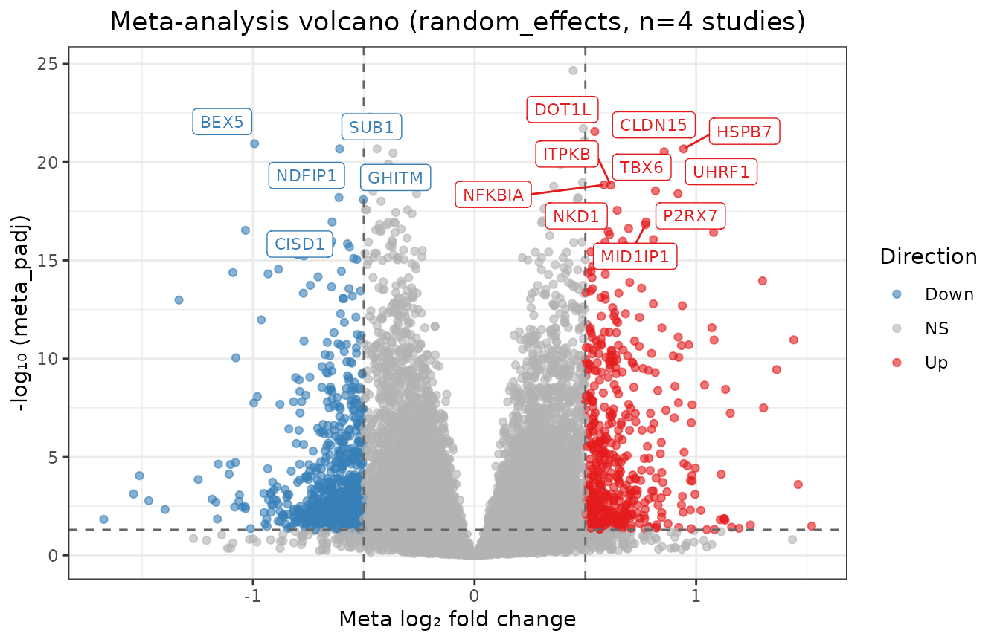
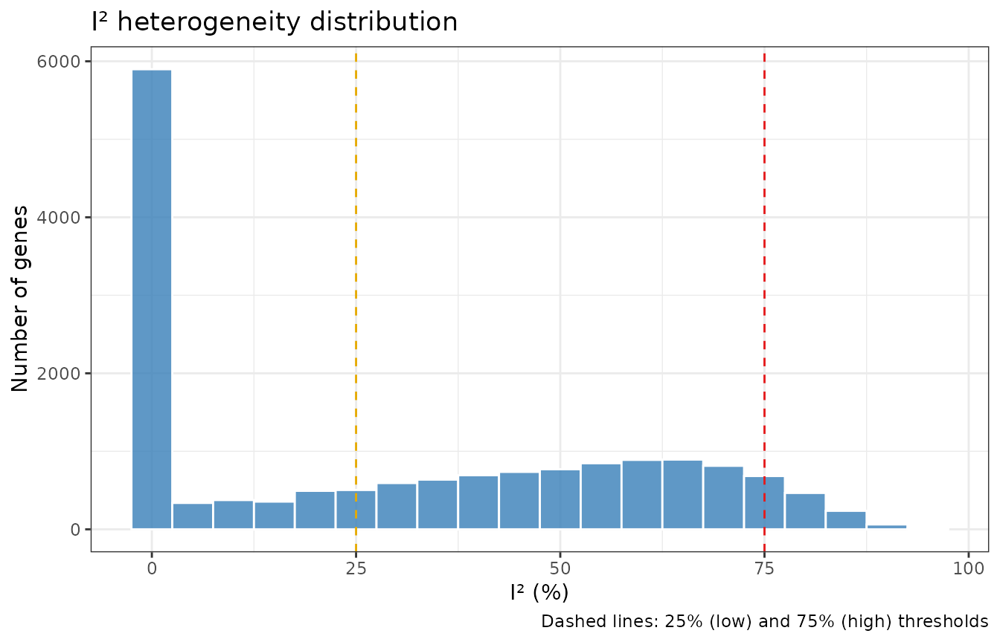
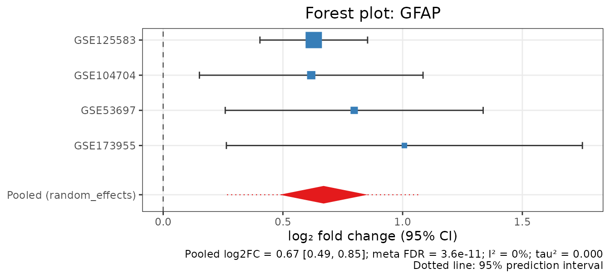
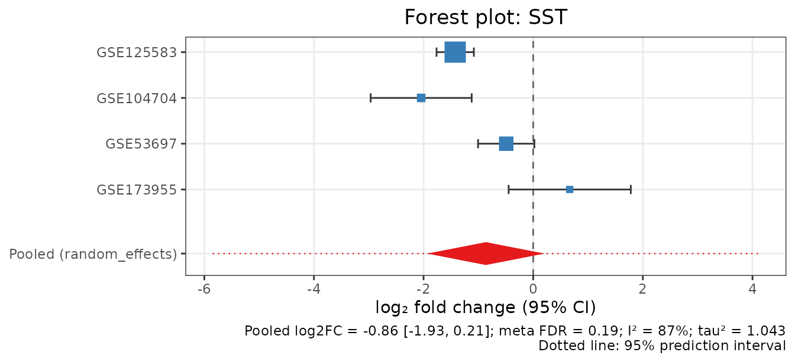
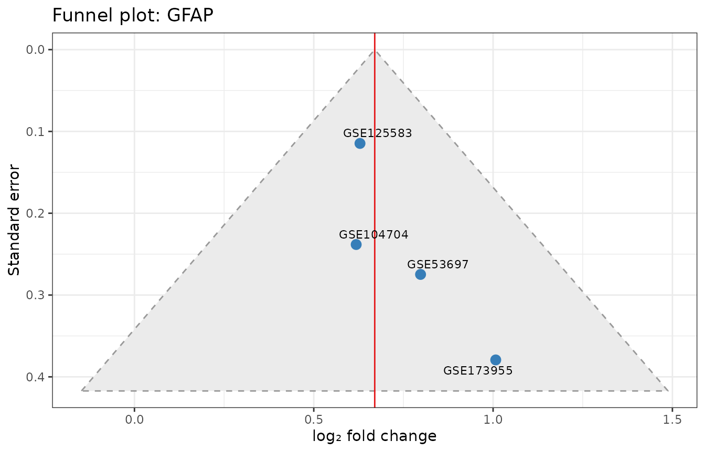
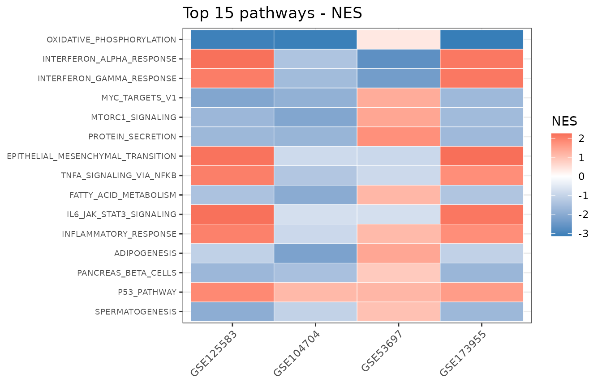

# Case study: Alzheimer's disease brain meta-analysis

This vignette is a complete, executable meta-analysis of published bulk
RNA-seq data. It walks through the decisions a reviewer will ask about:
study selection, independence, model choice, heterogeneity, robustness
and pathway inference. Every number below is computed when the vignette
is built.

``` r

library(metaXpress)
```

## 1. Question and study selection

**Question:** which genes are consistently differentially expressed in
Alzheimer’s disease (AD) brain tissue compared with age-matched
controls, across brain regions and cohorts?

The candidates were human post-mortem brain bulk RNA-seq series in GEO
with an AD vs non-demented control design and raw counts from the NCBI
GEO RNA-seq pipeline. These four were **included**:

| GEO | Region | AD | Control | Notes |
|----|----|---:|---:|----|
| [GSE125583](https://www.ncbi.nlm.nih.gov/geo/query/acc.cgi?acc=GSE125583) | Fusiform gyrus | 218 | 70 | Adjusted for sex |
| [GSE104704](https://www.ncbi.nlm.nih.gov/geo/query/acc.cgi?acc=GSE104704) | Lateral temporal lobe | 12 | 10 | Aged controls only; young controls excluded |
| [GSE53697](https://www.ncbi.nlm.nih.gov/geo/query/acc.cgi?acc=GSE53697) | Dorsolateral PFC | 6 | 6 | NCBI processed 12 of 17 libraries |
| [GSE173955](https://www.ncbi.nlm.nih.gov/geo/query/acc.cgi?acc=GSE173955) | Hippocampus | 8 | 10 |  |

These two were **excluded** because their donors overlap with included
studies, which would count the same individuals twice:

- **GSE95587** (fusiform gyrus): 89 of its 117 case IDs also appear in
  GSE125583.
- **GSE159699** (lateral temporal lobe): the same brain-bank donors as
  GSE104704.

Meta-analysis assumes the studies are independent. Checking donor and
case identifiers across series from the same lab or brain bank is
essential.

### How the per-study results were produced

The per-study DESeq2 results are shipped with the package. They were
built by `inst/scripts/make_ad_brain_extdata.R`, which runs:

``` r

studies <- mx_fetch_geo(
  c("GSE125583", "GSE104704", "GSE53697", "GSE173955"),
  condition_col = c(GSE125583 = "diagnosis:ch1",
                    GSE104704 = "study group:ch1",
                    GSE53697  = "disease status:ch1",
                    GSE173955 = "title"))
# ... keep AD and control samples, protein-coding genes,
#     >= 10 counts in >= (smaller group size) samples ...
studies <- mx_de_all(
  studies, method = "DESeq2",
  formula  = list(~ sex + condition, ~ condition, ~ condition, ~ condition),
  contrast = list(c("Alzheimer's disease", "control"),
                  c("Aged, diseased", "Old"),
                  c("advanced Alzheimer's Disease", "control"),
                  c("Alzheimer's Disease", "non-Alzheimer's Disease")))
```

Three choices in this code matter:

- [`mx_fetch_geo()`](https://mdjubayerhossain.com/metaXpress/reference/mx_fetch_geo.md)
  downloads **NCBI-generated raw counts**: one HISAT2 and featureCounts
  pipeline on GRCh38 for every study. This removes the aligner and
  annotation differences that usually add technical heterogeneity
  between published count tables.
- `contrast` is set per study because GEO labels differ (“control”,
  “Old”, “non-Alzheimer’s Disease”). Every fold change is AD / control.
- Batch correction is **not** applied. Each study is analysed
  separately, so between-study batch effects never enter the fold
  changes.

``` r

ad <- readRDS(system.file("extdata", "ad_brain_de.rds",
                          package = "metaXpress"))
de <- ad$de_results
ad$studies
#>   accession                region n_AD n_control n_genes n_DEG_fdr05
#> 1 GSE125583        Fusiform gyrus  218        70   16126       10164
#> 2 GSE104704 Lateral temporal lobe   12        10   15930        1670
#> 3  GSE53697      Dorsolateral PFC    6         6   16029           1
#> 4 GSE173955           Hippocampus    8        10   15905        4149
#>            formula
#> 1 ~sex + condition
#> 2       ~condition
#> 3       ~condition
#> 4       ~condition
str(ad$provenance)
#> List of 5
#>  $ built     : chr "2026-10-14"
#>  $ counts    : chr "NCBI GEO RNA-seq pipeline, GRCh38.p13, NCBI RefSeq genes"
#>  $ de        : chr "DESeq2 1.52.0 Wald test, unshrunken MLE log2FC"
#>  $ filter    : chr "protein-coding; >= 10 counts in >= smaller-group-size samples"
#>  $ metaXpress: chr "0.99.1"
```

## 2. Pre-pooling checks

### Direction and concordance

``` r

mx_study_concordance(de)
#>     study_1   study_2 n_genes correlation sign_agreement             flag
#> 1 GSE125583 GSE104704   10096  0.75221718      0.8502377               ok
#> 2 GSE125583  GSE53697    9841  0.09469926      0.5314501 weak concordance
#> 3 GSE125583 GSE173955   10722  0.80043218      0.8740907               ok
#> 4 GSE104704  GSE53697    1654  0.38697724      0.6813785               ok
#> 5 GSE104704 GSE173955    5062  0.67807809      0.8609245               ok
#> 6  GSE53697 GSE173955    4078  0.29992966      0.6066699               ok
```

No study pair is negatively correlated, so the contrasts are oriented
consistently. Concordance between the three larger cohorts is high. The
dorsolateral PFC study (6 vs 6) correlates weakly with the others, which
is expected for a small study of a less affected region.

### Gene coverage

Genes removed by the expression filter in a study are treated as *not
measured* in that study, not as zero effects.
[`mx_meta()`](https://mdjubayerhossain.com/metaXpress/reference/mx_meta.md)
pools each gene over the studies that measured it, and `n_studies`
records how many that was.

``` r

cov <- mx_missing_summary(de)
colSums(cov)                              # genes measured per study
#> GSE125583 GSE104704  GSE53697 GSE173955 
#>     16126     15930     16029     15905
table(studies_measured = rowSums(cov))    # genes by number of studies
#> studies_measured
#>     1     2     3     4 
#>   427   601   399 15291
```

Imputing missing fold changes from the other studies is circular: it
inflates the apparent number of studies and deflates I². It is not used
here.

## 3. Choosing the model

The aim is to estimate the average AD effect across regions and cohorts,
which are expected to differ. That makes a **random-effects** model the
appropriate a-priori choice. tau² is estimated by REML, which is less
biased than DerSimonian-Laird (Veroniki et al. 2016; Langan et
al. 2019).

``` r

res <- mx_meta(de, method = "random_effects", tau_method = "REML")
res
#> metaXpressResult
#>   Method    : random_effects 
#>   Studies   : 4 
#>   Genes     : 16290 
#>   Sig genes : 7491 (meta_padj <= 0.05)
mt <- res@meta_table
```

Other methods answer different questions, so they are not alternatives
to try until something comes out significant:

``` r

n_sig <- function(...) sum(mx_meta(de, ...)@meta_table$meta_padj <= 0.05)
data.frame(
  method   = c("random_effects (REML)", "fixed_effects",
               "inverse_normal (sqrt n)", "fisher (directional)",
               "rop (r = 2 of 4)", "maxp (all 4)", "awmeta"),
  question = c("average effect across populations",
               "one common effect (studies are replicates)",
               "signed evidence, weighted by sample size",
               "same-direction effect in at least one study",
               "DE in at least 2 studies",
               "DE in every study",
               "AW-Fisher: DE in an adaptively selected subset"),
  n_FDR05  = c(n_sig(method = "random_effects"),
               n_sig(method = "fixed_effects"),
               n_sig(method = "inverse_normal"),
               n_sig(method = "fisher"),
               n_sig(method = "rop", r = 2),
               n_sig(method = "maxp"),
               if (requireNamespace("AWFisher", quietly = TRUE))
                 n_sig(method = "awmeta") else NA))
#>                    method                                       question
#> 1   random_effects (REML)              average effect across populations
#> 2           fixed_effects     one common effect (studies are replicates)
#> 3 inverse_normal (sqrt n)       signed evidence, weighted by sample size
#> 4    fisher (directional)    same-direction effect in at least one study
#> 5        rop (r = 2 of 4)                       DE in at least 2 studies
#> 6            maxp (all 4)                              DE in every study
#> 7                  awmeta AW-Fisher: DE in an adaptively selected subset
#>   n_FDR05
#> 1    7491
#> 2   10861
#> 3   10906
#> 4   10699
#> 5    7615
#> 6    1622
#> 7   10284
```

The fixed-effect and p-value methods call more genes because they ignore
between-study variance. With one cohort of n = 288, they mostly reflect
that cohort.

### A note on the Hartung-Knapp-Sidik-Jonkman (HKSJ) adjustment

HKSJ gives better-calibrated confidence intervals when few studies are
pooled, and is widely recommended for clinical meta-analysis (IntHout et
al. 2014). With k = 4 studies, though, it uses a t distribution with 3
degrees of freedom:

``` r

hk <- mx_meta(de, tau_method = "REML", hksj = TRUE)@meta_table
c(min_p = min(hk$meta_pvalue),
  BH_threshold_for_one_hit = 0.05 / nrow(hk),
  n_FDR05 = sum(hk$meta_padj <= 0.05))
#>                    min_p BH_threshold_for_one_hit                  n_FDR05 
#>             1.323737e-05             3.069368e-06             0.000000e+00
```

Even a gene with perfectly consistent effects reaches only p ≈ 1e-5.
That cannot pass genome-wide FDR control over about 16,000 genes. With
few studies, use HKSJ for per-gene confidence intervals of prioritised
genes, not for genome-wide discovery.

## 4. Results

``` r

sig <- mt$meta_padj <= 0.05
c(tested = nrow(mt), significant = sum(sig),
  up = sum(sig & mt$meta_log2FC > 0), down = sum(sig & mt$meta_log2FC < 0),
  pi_excludes_zero = sum(sig & (mt$pi_lower > 0 | mt$pi_upper < 0),
                         na.rm = TRUE))
#>           tested      significant               up             down 
#>            16290             7491             3585             3906 
#> pi_excludes_zero 
#>             2133
```

The last number counts significant genes whose 95% **prediction
interval** excludes zero. For these genes, a new cohort is expected to
show the same direction of change. They are the most transferable part
of the signature.

``` r

mx_volcano(res, padj_threshold = 0.05, lfc_threshold = 0.5, label_top = 15)
```



``` r

mx_heterogeneity_plot(res)
```



### Known AD biology

``` r

known <- c("GFAP", "C4B", "CD44", "VIP", "VGF", "BDNF", "CRH", "NPTX2",
           "SST", "PVALB")
k_tab <- mt[match(known, mt$gene_id),
            c("gene_id", "meta_log2FC", "ci_lower", "ci_upper", "meta_padj",
              "i_squared", "pi_lower", "pi_upper")]
k_tab[, -1] <- signif(k_tab[, -1], 3)
k_tab
#>       gene_id meta_log2FC ci_lower ci_upper meta_padj i_squared pi_lower
#> 12616    GFAP       0.670    0.486    0.854  3.60e-11       0.0  0.26700
#> 5158      C4B       0.438    0.235    0.641  1.43e-04      31.0 -0.00815
#> 8528     CD44       0.483    0.119    0.846  2.35e-02      38.2 -0.54400
#> 5678      VIP      -0.609   -0.807   -0.411  2.78e-08       0.0 -1.04000
#> 6220      VGF      -1.470   -2.290   -0.656  1.67e-03      86.5 -5.19000
#> 8497     BDNF      -0.847   -1.300   -0.392  1.15e-03      73.4 -2.80000
#> 6741      CRH      -1.540   -2.340   -0.739  7.63e-04      76.5 -5.05000
#> 6150    NPTX2      -1.040   -1.650   -0.424  3.33e-03      78.5 -3.75000
#> 3544      SST      -0.864   -1.930    0.206  1.87e-01      86.7 -5.85000
#> 15156   PVALB      -0.782   -1.970    0.404  2.91e-01      87.9 -6.31000
#>       pi_upper
#> 12616    1.070
#> 5158     0.883
#> 8528     1.510
#> 5678    -0.175
#> 6220     2.250
#> 8497     1.110
#> 6741     1.970
#> 6150     1.680
#> 3544     4.120
#> 15156    4.740
```

The meta-analysis recovers the expected pattern:

- **Up:** reactive glial and complement genes (GFAP, C4B, CD44).
- **Down:** neuronal and neuropeptide genes (VIP, VGF, BDNF, CRH,
  NPTX2).

The heterogeneity is informative in its own right. Interneuron markers
such as SST and PVALB have very high I² and are not significant on
average. Their loss depends on the region and the cohort, which is the
pattern expected if the signal partly reflects neuronal loss in the
sampled tissue.

``` r

mx_forest("GFAP", de, res)
```



``` r

mx_forest("SST", de, res)
```



AWmeta also records which studies carry each gene’s signal
(`aw_studies`). This shows whether a finding rests mainly on the large
fusiform-gyrus cohort:

``` r

aw <- mx_meta(de, method = "awmeta")@meta_table
aw_sig <- aw[aw$meta_padj <= 0.05, ]
head(sort(table(aw_sig$aw_studies), decreasing = TRUE), 5)
#> 
#>                    GSE125583;GSE173955          GSE125583;GSE104704;GSE173955 
#>                                   2614                                   2495 
#>                              GSE125583                    GSE125583;GSE104704 
#>                                   2424                                   1324 
#> GSE125583;GSE104704;GSE53697;GSE173955 
#>                                    381
aw[match(c("GFAP", "VGF", "SST"), aw$gene_id),
   c("gene_id", "meta_log2FC", "meta_padj", "aw_studies")]
#>       gene_id meta_log2FC    meta_padj                             aw_studies
#> 12616    GFAP   0.6699707 6.088242e-09 GSE125583;GSE104704;GSE53697;GSE173955
#> 6220      VGF  -1.8186881 1.389237e-28          GSE125583;GSE104704;GSE173955
#> 3544      SST  -1.5795883 1.993527e-16                    GSE125583;GSE104704
```

Most AWmeta-significant genes rest on GSE125583 alone or together with
one other cohort.

SST shows how the two hypotheses differ. AWmeta calls it significant
because it selects the two cohorts with a strong loss and ignores the
others. Random effects asks for an *average* effect across all cohorts
and does not call it significant (I² = 87%). Report which hypothesis was
tested.

## 5. Robustness

``` r

loo <- mx_sensitivity(de, method = "random_effects", tau_method = "REML")
vapply(loo, function(r) sum(r@meta_table$meta_padj <= 0.05), integer(1))
#> GSE125583 GSE104704  GSE53697 GSE173955 
#>      1550      5541      8123      6256
rob <- attr(loo, "robustness")
core <- rob[rob$full_padj <= 0.05 & rob$frac_loo_sig == 1, ]
nrow(core)
#> [1] 1239
```

Removing GSE125583 (n = 288) shrinks the result most, which shows how
much statistical power that single cohort provides. The **core
signature** of 1239 genes stays significant, with the same direction,
after omitting any single study. These are the genes to report as robust
findings and to prioritise for validation.

### Small-study effects

Do the smaller cohorts report systematically larger effects? With four
studies these tests have very little power: Sterne et al. (2011) advise
against them below 10 studies. They are shown here as a template and
must not be read as evidence that no bias exists.

``` r

ss <- suppressWarnings(mx_small_study(de, genes = core$gene_id))
c(tested = nrow(ss), egger_FDR05 = sum(ss$egger_padj <= 0.05, na.rm = TRUE))
#>      tested egger_FDR05 
#>        1239           0
mx_funnel("GFAP", de, res)
```



## 6. Pathways

### Enrichment of the meta-signature

``` r

res <- mx_pathway_meta(res, db = "Hallmarks", method = "GSEA")
head(res@pathway_result[, c("pathway_id", "NES", "padj")], 10)
#>                            pathway_id       NES         padj
#> 36 HALLMARK_OXIDATIVE_PHOSPHORYLATION -3.077706 4.911417e-31
#> 32            HALLMARK_MYC_TARGETS_V1 -1.991422 1.638455e-06
#> 45   HALLMARK_TNFA_SIGNALING_VIA_NFKB  1.687966 1.134809e-03
#> 24   HALLMARK_IL6_JAK_STAT3_SIGNALING  1.835387 2.403652e-03
#> 37               HALLMARK_P53_PATHWAY  1.569513 3.566265e-03
#> 25     HALLMARK_INFLAMMATORY_RESPONSE  1.588698 4.989763e-03
#> 30           HALLMARK_MITOTIC_SPINDLE  1.510185 7.988942e-03
#> 13               HALLMARK_E2F_TARGETS  1.440066 1.429704e-02
#> 34                HALLMARK_MYOGENESIS  1.425479 1.429704e-02
#> 12                HALLMARK_DNA_REPAIR -1.535410 1.429704e-02
```

### Cross-study pathway meta-analysis

A complementary test runs GSEA within each study and combines the
pathway-level evidence. Pathways enriched in opposite directions cancel
out, and the `n_up` and `n_down` columns show the direction in each
study.

``` r

ps <- mx_pathway_studies(de, db = "Hallmarks")
head(ps[, c("pathway_id", "mean_NES", "n_up", "n_down", "n_sig",
            "meta_padj")], 10)
#>                                    pathway_id   mean_NES n_up n_down n_sig
#> 1          HALLMARK_OXIDATIVE_PHOSPHORYLATION -2.2363250    1      3     3
#> 2  HALLMARK_EPITHELIAL_MESENCHYMAL_TRANSITION  0.6665349    2      2     2
#> 3                     HALLMARK_MYC_TARGETS_V1 -1.0759817    1      3     4
#> 4                        HALLMARK_P53_PATHWAY  1.4305846    4      0     2
#> 5                   HALLMARK_MTORC1_SIGNALING -1.0001310    1      3     4
#> 6              HALLMARK_INFLAMMATORY_RESPONSE  0.9938056    3      1     2
#> 7            HALLMARK_IL6_JAK_STAT3_SIGNALING  0.7194004    2      2     2
#> 8                     HALLMARK_MYC_TARGETS_V2 -1.3723082    0      4     2
#> 9              HALLMARK_FATTY_ACID_METABOLISM -0.9093851    1      3     2
#> 10                HALLMARK_TGF_BETA_SIGNALING  1.3541580    4      0     1
#>       meta_padj
#> 1  1.681209e-62
#> 2  3.470711e-08
#> 3  3.642160e-08
#> 4  1.157411e-07
#> 5  1.615409e-06
#> 6  1.797501e-06
#> 7  1.670032e-05
#> 8  1.050266e-04
#> 9  2.457621e-04
#> 10 2.457621e-04
mx_pathway_heatmap(attr(ps, "per_study"), top_n = 15, value = "NES")
```



Both analyses agree on the two main themes:

- **Loss of mitochondrial oxidative phosphorylation** (down in 3 of 4
  cohorts).
- **Gain of inflammatory signalling** (TNF-alpha/NF-kB, IL6/JAK/STAT3).

## 7. Reporting

``` r

mx_export(res, format = "csv", output_dir = "results")
mx_report(res, de, output_dir = "results")   # HTML report with methods text
```

A methods section should state:

- the study inclusion and exclusion criteria, including the
  donor-overlap check;
- the count source (NCBI GEO pipeline) and the per-study DE model and
  covariates;
- the meta-analysis model (random effects, REML tau²);
- FDR control (Benjamini-Hochberg);
- I², tau² and prediction intervals for the reported genes;
- the leave-one-out robust core.

## References

- Higgins, J.P.T., Thompson, S.G. & Spiegelhalter, D.J. (2009) A
  re-evaluation of random-effects meta-analysis. *J R Stat Soc A* 172,
  137-159.
- IntHout, J., Ioannidis, J.P.A. & Borm, G.F. (2014) The
  Hartung-Knapp-Sidik-Jonkman method for random effects meta-analysis.
  *BMC Med Res Methodol* 14, 25.
- Langan, D. et al. (2019) A comparison of heterogeneity variance
  estimators in simulated random-effects meta-analyses. *Res Synth
  Methods* 10, 83-98.
- Shen, K. & Tseng, G.C. (2010) Meta-analysis for pathway enrichment
  analysis when combining multiple genomic studies. *Bioinformatics* 26,
  1316-1323.
- Heberle, B.A. et al. (2024) Systematic review and meta-analysis of
  bulk RNAseq studies in human Alzheimer’s disease brain tissue.
  *bioRxiv* <doi:10.1101/2024.11.07.622520>.

``` r

sessionInfo()
#> R version 4.6.1 (2026-06-24)
#> Platform: x86_64-pc-linux-gnu
#> Running under: Ubuntu 24.04.5 LTS
#> 
#> Matrix products: default
#> BLAS:   /usr/lib/x86_64-linux-gnu/openblas-pthread/libblas.so.3 
#> LAPACK: /usr/lib/x86_64-linux-gnu/openblas-pthread/libopenblasp-r0.3.26.so;  LAPACK version 3.12.0
#> 
#> locale:
#>  [1] LC_CTYPE=C.UTF-8       LC_NUMERIC=C           LC_TIME=C.UTF-8       
#>  [4] LC_COLLATE=C.UTF-8     LC_MONETARY=C.UTF-8    LC_MESSAGES=C.UTF-8   
#>  [7] LC_PAPER=C.UTF-8       LC_NAME=C              LC_ADDRESS=C          
#> [10] LC_TELEPHONE=C         LC_MEASUREMENT=C.UTF-8 LC_IDENTIFICATION=C   
#> 
#> time zone: UTC
#> tzcode source: system (glibc)
#> 
#> attached base packages:
#> [1] stats     graphics  grDevices utils     datasets  methods   base     
#> 
#> other attached packages:
#> [1] metaXpress_0.99.1
#> 
#> loaded via a namespace (and not attached):
#>  [1] SummarizedExperiment_1.42.0 fastmatch_1.1-8            
#>  [3] gtable_0.3.6                xfun_0.61                  
#>  [5] bslib_0.12.0                ggplot2_4.0.3              
#>  [7] htmlwidgets_1.6.4           ggrepel_0.9.8              
#>  [9] Biobase_2.72.0              lattice_0.22-9             
#> [11] vctrs_0.7.3                 tools_4.6.1                
#> [13] generics_0.1.4              stats4_4.6.1               
#> [15] parallel_4.6.1              tibble_3.3.1               
#> [17] pkgconfig_2.0.3             Matrix_1.7-5               
#> [19] data.table_1.18.6.1         RColorBrewer_1.1-3         
#> [21] S7_0.2.2                    desc_1.4.3                 
#> [23] S4Vectors_0.50.3            assertthat_0.2.1           
#> [25] lifecycle_1.0.5             compiler_4.6.1             
#> [27] farver_2.1.2                textshaping_1.0.5          
#> [29] statmod_1.5.2               fgsea_1.38.0               
#> [31] Seqinfo_1.2.0               codetools_0.2-20           
#> [33] htmltools_0.5.9             sass_0.4.10                
#> [35] yaml_2.3.12                 pillar_1.11.1              
#> [37] pkgdown_2.2.1               jquerylib_0.1.4            
#> [39] BiocParallel_1.46.0         DelayedArray_0.38.2        
#> [41] cachem_1.1.0                limma_3.68.5               
#> [43] abind_1.4-8                 tidyselect_1.2.1           
#> [45] locfit_1.5-9.12             digest_0.6.39              
#> [47] dplyr_1.2.1                 labeling_0.4.3             
#> [49] cowplot_1.2.0               fastmap_1.2.0              
#> [51] grid_4.6.1                  SparseArray_1.12.3         
#> [53] cli_3.6.6                   magrittr_2.0.5             
#> [55] S4Arrays_1.12.1             withr_3.0.3                
#> [57] edgeR_4.10.5                scales_1.4.0               
#> [59] XVector_0.52.0              rmarkdown_2.32             
#> [61] matrixStats_1.5.0           otel_0.2.0                 
#> [63] ragg_1.5.2                  evaluate_1.0.5             
#> [65] knitr_1.52                  AWFisher_1.26.0            
#> [67] GenomicRanges_1.64.0        IRanges_2.46.0             
#> [69] msigdbr_26.1.1              rlang_1.3.0                
#> [71] Rcpp_1.1.2                  glue_1.8.1                 
#> [73] BiocGenerics_0.58.1         jsonlite_2.0.0             
#> [75] R6_2.6.1                    MatrixGenerics_1.24.0      
#> [77] systemfonts_1.3.2           fs_2.1.0
```
