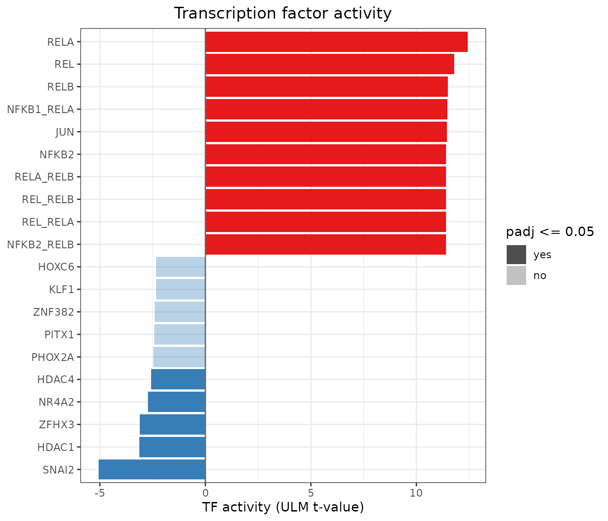
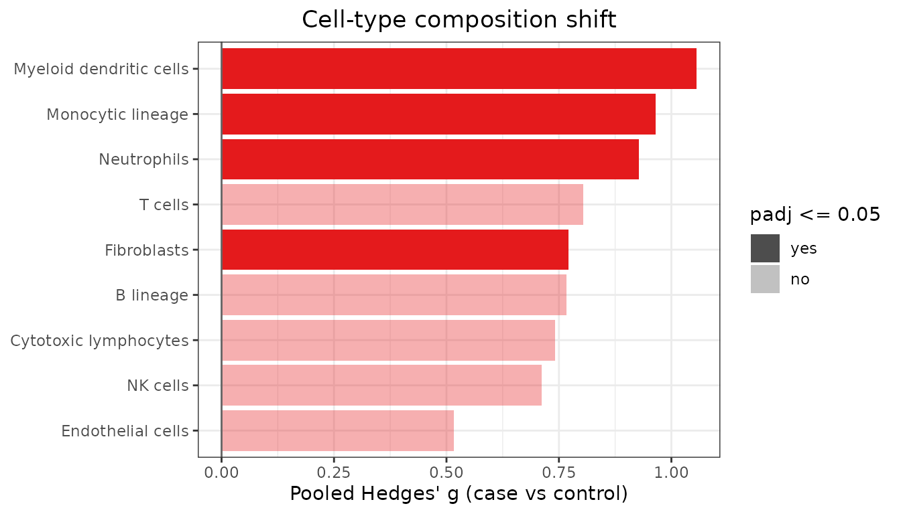
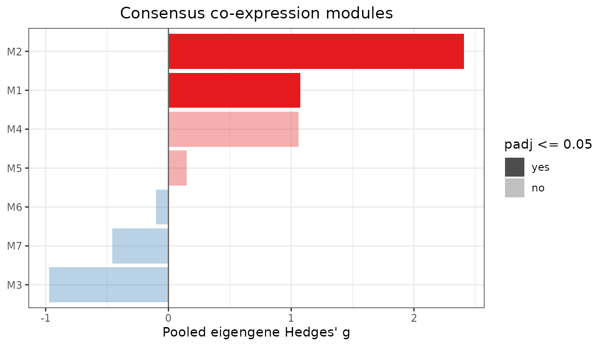
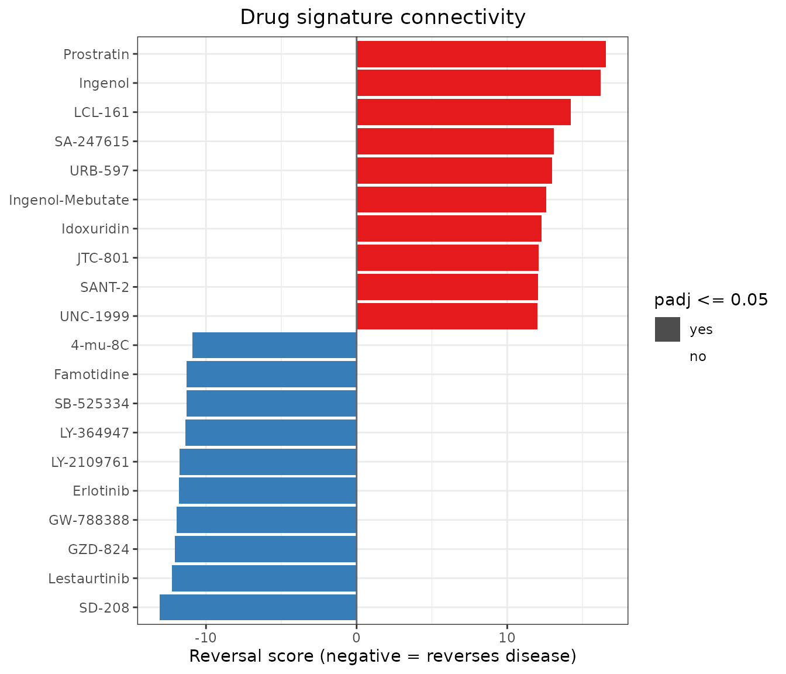

# Downstream biology: from meta-signature to mechanism

A list of meta-DEGs is the starting point for biology, not the end.
Module 9 turns a meta-signature into testable hypotheses using public
prior knowledge. It answers four questions:

1.  **Transcription factors.** Which regulators explain the signature?
2.  **Cell composition.** Is the signature caused by shifts in cell
    types?
3.  **Co-expression.** Which gene programs are shared by all cohorts?
4.  **Drug reversal.** Which compounds reverse the disease state?

The demo is a meta-analysis of **pancreatic ductal adenocarcinoma (PDAC)
versus adjacent non-tumour pancreas** in three independent GEO cohorts:

| GEO       | Tumour / non-tumour |
|-----------|---------------------|
| GSE130688 | 15 / 15             |
| GSE136569 | 5 / 5               |
| GSE171485 | 6 / 6               |

All counts are NCBI GEO-generated raw counts. Sample labels come from
the GEO series metadata. The shipped file contains real inputs:

- the **genome-wide** random-effects (REML) meta-analysis (29,679
  genes);
- the three cohorts, restricted to cell-type markers and the 1,500 most
  variable genes, with their true library sizes;
- the CollecTRI TF-target network (Mueller-Dott et al. 2023);
- MCP-counter markers (Becht et al. 2016);
- 200 LINCS L1000 drug signatures (Subramanian et al. 2017).

The file is rebuilt by `scripts/fetch_case_study_data.R`,
`scripts/run_case_study_applications.R` and
`scripts/make_downstream_extdata.R` in the source repository.

``` r

library(metaXpress)
ds <- readRDS(system.file("extdata", "case_study_downstream.rds",
                          package = "metaXpress"))
ds$meta_result
#> metaXpressResult
#>   Method    : random_effects 
#>   Studies   : 3 
#>   Genes     : 29679 
#>   Sig genes : 2739 (meta_padj <= 0.05)
nrow(ds$collectri)     # TF-target interactions
#> [1] 62411
length(ds$lincs)       # drug signatures in the demo subset
#> [1] 200
```

## 1. Transcription factor activity

Which upstream regulators explain the PDAC tumour program?
[`mx_tf_activity()`](https://mdjubayerhossain.com/metaXpress/reference/mx_tf_activity.md)
regresses the signed meta z-score of every gene on each TF’s target
weights (decoupleR’s ULM method):

``` r

tf <- mx_tf_activity(ds$meta_result, ds$collectri, id_col = "symbol",
                     min_size = 10)
head(tf, 10)
#>         source    score       pvalue         padj n_targets
#> 1         RELA 12.43113 2.190009e-35 1.208885e-32       878
#> 2          REL 11.79518 4.910641e-32 1.355337e-29       740
#> 3         RELB 11.49657 1.604001e-30 1.825671e-28       740
#> 4   NFKB1_RELA 11.46201 2.387745e-30 1.825671e-28       724
#> 5          JUN 11.44083 3.045100e-30 1.825671e-28       799
#> 6        NFKB2 11.41726 3.989507e-30 1.825671e-28       741
#> 7  NFKB1_NFKB2 11.39821 4.961063e-30 1.825671e-28       724
#> 8    NFKB1_REL 11.39821 4.961063e-30 1.825671e-28       724
#> 9   NFKB1_RELB 11.39821 4.961063e-30 1.825671e-28       724
#> 10   NFKB2_REL 11.39821 4.961063e-30 1.825671e-28       724
mx_downstream_plot(tf, top = 20)
```



These results use the genome-wide meta-signature. Of 552 TFs with at
least 10 measured targets, 148 are significant (FDR \< 0.05):

- **NF-kB** (RELA, REL, RELB, NFKB1/2) and **AP-1** (JUN) dominate. This
  is the inflammatory signalling of the PDAC tumour microenvironment.
- **E2F1/E2F4, MYC and TP53 targets** are also activated. Proliferation
  and p53-pathway target genes are up in tumour.
- **SNAI2** and the HDACs HDAC1 and HDAC4 are the significantly
  repressed regulators.

## 2. Cell-type composition

Could the signal be caused by tumours simply containing more immune or
stromal cells?
[`mx_cell_composition()`](https://mdjubayerhossain.com/metaXpress/reference/mx_cell_composition.md)
scores each sample for each cell type, computes Hedges’ g per cohort and
pools them:

``` r

comp <- mx_cell_composition(ds$studies, ds$markers)
comp[, c("cell_type", "meta_g", "padj", "i_squared",
         grep("^g_", names(comp), value = TRUE))]
#>                 cell_type    meta_g       padj i_squared g_GSE130688_PDAC
#> 1             Neutrophils 0.9281460 0.01090392   0.00000         1.042683
#> 2       Monocytic lineage 0.9647060 0.01090392  12.46898         1.362890
#> 3 Myeloid dendritic cells 1.0560312 0.01090392  26.87887         1.575953
#> 4             Fibroblasts 0.7719586 0.01712301   0.00000         1.025066
#> 5                 T cells 0.8038822 0.10039007  46.24228         1.321310
#> 6   Cytotoxic lymphocytes 0.7407763 0.10039007  45.19062         1.338888
#> 7               B lineage 0.7670349 0.10039007  49.22645         1.351987
#> 8                NK cells 0.7115487 0.10424301  47.18076         1.332464
#> 9       Endothelial cells 0.5160968 0.14135647  27.70855         0.962206
#>   g_GSE136569_PDAC g_GSE171485_PDAC
#> 1       0.63849360        0.9034475
#> 2       0.24596432        0.8365322
#> 3       0.41221790        0.7814624
#> 4       0.20317053        0.6791499
#> 5      -0.12621684        0.9129071
#> 6      -0.03987553        0.5829234
#> 7      -0.12978158        0.7673988
#> 8      -0.05681140        0.5239792
#> 9      -0.24602668        0.4034735
mx_downstream_plot(comp)
```



Neutrophils, monocytic cells, myeloid dendritic cells and fibroblasts
are significantly higher in tumour (FDR \< 0.05) and homogeneous across
cohorts (I² ≤ 27%). This is the desmoplastic, myeloid-rich stroma
typical of PDAC. Lymphocyte scores are higher in two cohorts but not in
GSE136569, so they are heterogeneous and not significant.

The implication for interpretation: part of the gene-level signature
reflects **tissue composition**, not tumour-cell-intrinsic regulation.
Inflammatory and ECM genes in particular should be read with this in
mind. CD8 T cells are dropped because only one of their markers was
measured.

## 3. Consensus co-expression modules

[`mx_coexpression_modules()`](https://mdjubayerhossain.com/metaXpress/reference/mx_coexpression_modules.md)
finds gene programs whose co-expression holds in **every** cohort
(minimum correlation across studies), then tests each module’s eigengene
between tumour and normal:

``` r

net <- mx_coexpression_modules(ds$studies, n_genes = 1500, cut_height = 0.3,
                               min_module_size = 20,
                               meta_result = ds$meta_result)
ms <- net$module_stats
# Hub genes are Entrez IDs; show symbols stored in rowData
sym <- setNames(SummarizedExperiment::rowData(ds$studies[[1]])$symbol,
                rownames(ds$studies[[1]]))
ms$hub_genes <- vapply(strsplit(ms$hub_genes, ", "),
                       function(g) paste(sym[g], collapse = ", "), character(1))
ms[, c("module", "n_genes", "meta_g", "padj", "pct_meta_up", "hub_genes")]
#>   module n_genes     meta_g         padj pct_meta_up
#> 1     M2     279  2.4058763 0.0001507716    76.70251
#> 2     M1     825  1.0753048 0.0096953003    22.66667
#> 3     M3      93 -0.9722924 0.0589553432     0.00000
#> 4     M4      59  1.0582353 0.1523270848    10.16949
#> 5     M7      21 -0.4564404 0.3825758256     0.00000
#> 6     M5      43  0.1487603 0.6945952310     0.00000
#> 7     M6      21 -0.1013718 0.8174084496     0.00000
#>                                    hub_genes
#> 1        MST1R, TSPAN1, B3GNT3, ITGB4, PLEK2
#> 2            TPM4, RFTN1, PXDN, ABCA1, LAMA4
#> 3  PNLIPRP1, CELP, CUZD1, FAM24B-CUZD1, CPA2
#> 4 IGKJ1, IGLJ2, IGKV3-15, IGKV3-20, IGKV2-28
#> 5 RNA45SN5, RNA45SN1, RNA28SN3, NA, RNA45SN4
#> 6         ITGA7, CHRDL1, FHL1, TMTC1, SCARA5
#> 7         PCSK2, SLC30A8, ABCC8, GAD2, UNC80
mx_downstream_plot(net)
```



Two modules are significant and a third shows a trend:

- **M2 (tumour epithelial, up).** The leading module (FDR = 1.5e-4) has
  **MST1R** (RON) as its top hub, with TSPAN1, B3GNT3, ITGB4 and PLEK2.
  77% of its genes are up-regulated meta-DEGs. MST1R is a recognised
  PDAC oncogene and therapeutic target.
- **M1 (stroma and ECM, up; FDR = 0.01).** Hubs include TPM4, PXDN and
  LAMA4, consistent with the fibroblast shift above.
- **M3 (acinar, down; FDR = 0.06).** PNLIPRP1, CELP, CUZD1 and CPA2 mark
  the loss of normal exocrine tissue in tumour samples.

The remaining modules capture immunoglobulin, ribosomal RNA, smooth
muscle and islet (PCSK2, SLC30A8, ABCC8) programs.

## 4. Drug signature reversal

Which compounds push expression in the opposite direction to the tumour
state?
[`mx_drug_connectivity()`](https://mdjubayerhossain.com/metaXpress/reference/mx_drug_connectivity.md)
scores each drug’s up/down gene sets against the meta-ranking (negative
= reverses the disease):

``` r

drugs <- mx_drug_connectivity(ds$meta_result, ds$lincs, id_col = "symbol")
head(drugs, 10)
#>            drug reversal_score       pvalue         padj cmap_score n_up n_down
#> 1        SD-208      -13.08356 4.088232e-39 1.635293e-37 -0.5380123  227    234
#> 2  Lestaurtinib      -12.25079 1.663613e-34 3.696917e-33 -0.5086122  230    231
#> 3       GZD-824      -12.06213 1.674016e-33 3.043666e-32 -0.4906545  223    217
#> 4     GW-788388      -11.94981 6.506993e-33 9.295704e-32 -0.5404217  233    228
#> 5     Erlotinib      -11.79395 4.194144e-32 5.592192e-31 -0.4839351  217    228
#> 6    LY-2109761      -11.75993 6.278994e-32 7.848742e-31 -0.5172403  231    236
#> 7     LY-364947      -11.37535 5.548204e-30 5.840215e-29 -0.5109724  227    229
#> 8     SB-525334      -11.29803 1.341968e-29 1.278065e-28 -0.5654886  230    229
#> 9    Famotidine      -11.28561 1.545572e-29 1.405065e-28 -0.4484308  222    224
#> 10      4-mu-8C      -10.89429 1.227160e-27 8.765430e-27 -0.4265940  221    224
mx_downstream_plot(drugs, top = 20)
```



**Five of the top eight compounds inhibit the TGF-beta type I receptor
ALK5:** SD-208, GW-788388, LY-2109761, LY-364947 and SB-525334. TGF-beta
drives PDAC stromal desmoplasia. The EGFR inhibitor **erlotinib**, which
is approved in combination with gemcitabine for advanced PDAC, ranks
fifth. This is a useful positive control for the method.

> **Caveats.** This demo ships only 200 of the 5,425 LINCS signatures,
> chosen from the full ranking, so the adjusted p-values here are not
> meaningful. Even in the full analysis the p-values assume independent
> genes and are anti-conservative, so use the score for ranking only.
> LINCS signatures come from cancer cell lines, so these hits are
> hypotheses for experimental follow-up. The full analysis is reproduced
> by `scripts/run_case_study_applications.R` in the package source
> repository.

``` r

sessionInfo()
#> R version 4.6.1 (2026-06-24)
#> Platform: x86_64-pc-linux-gnu
#> Running under: Ubuntu 24.04.5 LTS
#> 
#> Matrix products: default
#> BLAS:   /usr/lib/x86_64-linux-gnu/openblas-pthread/libblas.so.3 
#> LAPACK: /usr/lib/x86_64-linux-gnu/openblas-pthread/libopenblasp-r0.3.26.so;  LAPACK version 3.12.0
#> 
#> locale:
#>  [1] LC_CTYPE=C.UTF-8       LC_NUMERIC=C           LC_TIME=C.UTF-8       
#>  [4] LC_COLLATE=C.UTF-8     LC_MONETARY=C.UTF-8    LC_MESSAGES=C.UTF-8   
#>  [7] LC_PAPER=C.UTF-8       LC_NAME=C              LC_ADDRESS=C          
#> [10] LC_TELEPHONE=C         LC_MEASUREMENT=C.UTF-8 LC_IDENTIFICATION=C   
#> 
#> time zone: UTC
#> tzcode source: system (glibc)
#> 
#> attached base packages:
#> [1] stats     graphics  grDevices utils     datasets  methods   base     
#> 
#> other attached packages:
#> [1] metaXpress_0.99.1
#> 
#> loaded via a namespace (and not attached):
#>  [1] sass_0.4.10                 generics_0.1.4             
#>  [3] SparseArray_1.12.3          lattice_0.22-9             
#>  [5] digest_0.6.39               magrittr_2.0.5             
#>  [7] evaluate_1.0.5              grid_4.6.1                 
#>  [9] RColorBrewer_1.1-3          fastmap_1.2.0              
#> [11] Matrix_1.7-5                jsonlite_2.0.0             
#> [13] ggrepel_0.9.8               scales_1.4.0               
#> [15] codetools_0.2-20            textshaping_1.0.5          
#> [17] jquerylib_0.1.4             abind_1.4-8                
#> [19] cli_3.6.6                   rlang_1.3.0                
#> [21] XVector_0.52.0              Biobase_2.72.0             
#> [23] withr_3.0.3                 DelayedArray_0.38.2        
#> [25] cachem_1.1.0                yaml_2.3.12                
#> [27] otel_0.2.0                  S4Arrays_1.12.1            
#> [29] tools_4.6.1                 parallel_4.6.1             
#> [31] BiocParallel_1.46.0         dplyr_1.2.1                
#> [33] ggplot2_4.0.3               SummarizedExperiment_1.42.0
#> [35] BiocGenerics_0.58.1         vctrs_0.7.3                
#> [37] R6_2.6.1                    matrixStats_1.5.0          
#> [39] stats4_4.6.1                lifecycle_1.0.5            
#> [41] Seqinfo_1.2.0               S4Vectors_0.50.3           
#> [43] fs_2.1.0                    htmlwidgets_1.6.4          
#> [45] IRanges_2.46.0              ragg_1.5.2                 
#> [47] pkgconfig_2.0.3             desc_1.4.3                 
#> [49] pkgdown_2.2.1               pillar_1.11.1              
#> [51] bslib_0.12.0                gtable_0.3.6               
#> [53] glue_1.8.1                  Rcpp_1.1.2                 
#> [55] systemfonts_1.3.2           xfun_0.61                  
#> [57] tibble_3.3.1                GenomicRanges_1.64.0       
#> [59] tidyselect_1.2.1            MatrixGenerics_1.24.0      
#> [61] knitr_1.52                  farver_2.1.2               
#> [63] htmltools_0.5.9             labeling_0.4.3             
#> [65] rmarkdown_2.32              compiler_4.6.1             
#> [67] S7_0.2.2
```
