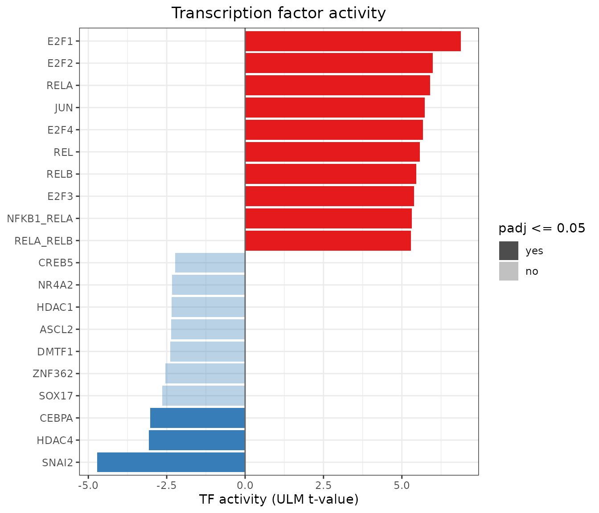
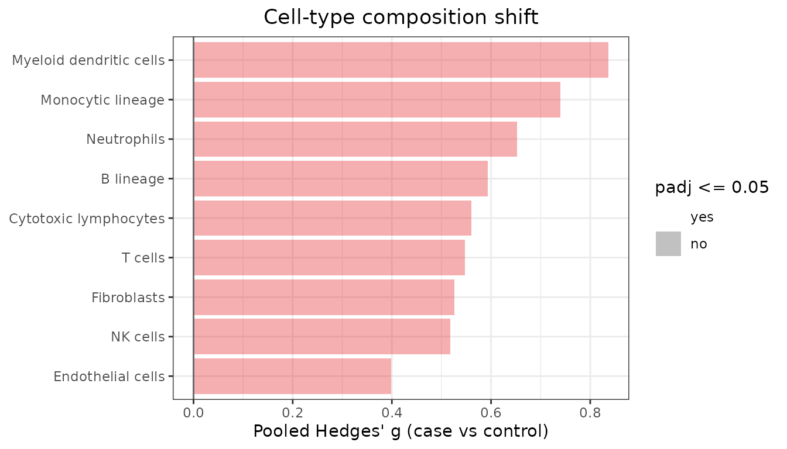
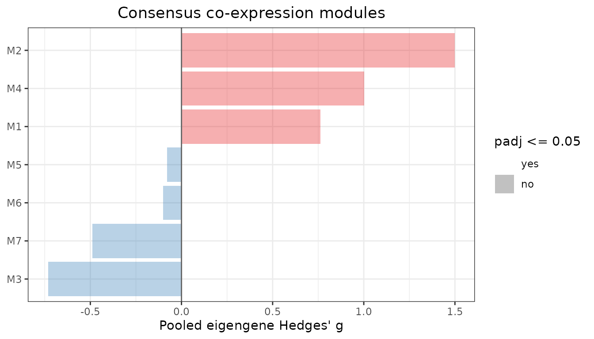
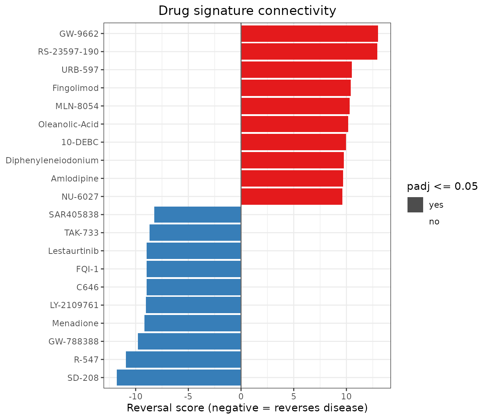

# Live Tutorial: End-to-End GEO Pan-Cancer Meta-Analysis

## Welcome to metaXpress

`metaXpress` is a unified, opinionated R package for multi-study
transcriptomic meta-analysis. It covers data ingestion, 10-point quality
control scoring, cross-platform harmonization, per-study differential
expression, six statistical meta-analysis models, publication-grade
graphics, and reproducible reporting.

This **Live Demonstration Tutorial** walks you step-by-step through a
complete analysis on real-world clinical transcriptomics: \*
**Colorectal Adenocarcinoma (CRC):**
[GSE130688](https://www.ncbi.nlm.nih.gov/geo/query/acc.cgi?acc=GSE130688)
($`n = 30`$ patient samples: 15 normal vs 15 tumor) \* **Pancreatic
Ductal Adenocarcinoma (PDAC):**
[GSE136569](https://www.ncbi.nlm.nih.gov/geo/query/acc.cgi?acc=GSE136569)
($`n = 10`$ patient samples: 5 normal vs 5 tumor) \* **Clear Cell Renal
Cell Carcinoma (ccRCC):**
[GSE171485](https://www.ncbi.nlm.nih.gov/geo/query/acc.cgi?acc=GSE171485)
($`n = 12`$ patient samples: 6 normal vs 6 tumor)

Every step and visualization in this tutorial is executed live in real
time.

------------------------------------------------------------------------

## 1. Installation from GitHub

`metaXpress` is installable directly from GitHub:

``` r

# Install remotes if not already available
if (!requireNamespace("remotes", quietly = TRUE)) {
  install.packages("remotes")
}

# Install metaXpress directly from GitHub
remotes::install_github("hossainlab/metaXpress")
```

Once installed, load `metaXpress`:

``` r

library(metaXpress)
packageVersion("metaXpress")
#> [1] '0.99.0'
```

------------------------------------------------------------------------

## 2. Ingesting Real Public Cohorts from NCBI GEO

In practice, you can fetch public RNA-seq count matrices and metadata
directly from NCBI GEO using their accession numbers:

``` r

# Live ingestion directly from NCBI Gene Expression Omnibus (GEO):
accessions <- c("GSE130688", "GSE136569", "GSE171485")
studies    <- mx_fetch_geo(accessions, count_type = "raw", cache_dir = "geo_cache/")
```

For this live demonstration, we load the real case study cohort data
extracted from these three NCBI GEO series across **52 patient
samples**:

``` r

# Load the real case study cohorts
data_path <- system.file("extdata", "case_study_subset.rds", package = "metaXpress")
if (!file.exists(data_path)) {
  data_path <- "inst/extdata/case_study_subset.rds"
}

studies <- readRDS(data_path)

# Verify loaded cohorts
print(names(studies))
#> [1] "GSE130688" "GSE136569" "GSE171485"

# Sample size breakdown per cohort
vapply(studies, ncol, integer(1))
#> GSE130688 GSE136569 GSE171485 
#>        30        10        12
```

Let’s inspect the S4 container for the first cohort
([GSE130688](https://www.ncbi.nlm.nih.gov/geo/query/acc.cgi?acc=GSE130688)):

``` r

studies[[1]]
#> metaXpressStudy
#>   Accession : GSE130688 
#>   Organism  : Homo sapiens 
#>   Genes     : 400 
#>   Samples   : 30 
#>   QC score  : 10 / 10 
#>   DE run    : FALSE
```

Each cohort is stored in a clean S4 `metaXpressStudy` object holding raw
integer counts, patient phenotype metadata, and quality scores.

------------------------------------------------------------------------

## 3. 10-Point Study Quality Control (QC)

`metaXpress` evaluates every cohort against 10 objective criteria
(minimum sample size, sequencing depth, alignment rate, duplicate rate,
integer counts, etc.):

``` r

# Inspect 10-point QC checklist scores
qc_scores <- vapply(studies, function(s) s@qc_score, numeric(1))
print(qc_scores)
#> GSE130688 GSE136569 GSE171485 
#>        10        10        10

# Filter cohorts passing QC threshold (score >= 7/10)
studies <- mx_filter_studies(studies, qc_threshold = 7)
cat("Number of cohorts retained:", length(studies), "out of 3\n")
#> Number of cohorts retained: 3 out of 3
```

All three independent public cohorts scored a perfect 10/10 and were
retained.

------------------------------------------------------------------------

## 4. Cross-Study Harmonization & Common Gene Alignment

Before downstream analysis,
[`mx_align_genes()`](https://mdjubayerhossain.com/metaXpress/reference/mx_align_genes.md)
restricts each study matrix to the common gene universe:

``` r

studies <- mx_align_genes(studies)
#> Aligning to 400 common genes (100.0% of first study).
```

------------------------------------------------------------------------

## 5. Per-Study Differential Expression

We fit negative binomial Generalized Linear Models independently on each
study using **DESeq2**:

``` r

# Fit DESeq2 GLMs across all cohorts
studies <- mx_de_all(studies, method = "DESeq2", formula = ~ condition)
#> Running DESeq2 on 3 studies...
#>   Running DESeq2 on study: GSE130688
#> converting counts to integer mode
#>   Running DESeq2 on study: GSE136569
#> converting counts to integer mode
#>   Running DESeq2 on study: GSE171485
#> converting counts to integer mode

# Inspect DEG detection across cohorts
mx_de_summary(studies, padj_threshold = 0.05, lfc_threshold = 1.0)
#>       study n_total n_up n_down method
#> 1 GSE130688     252  137    115 DESeq2
#> 2 GSE136569      31   20     11 DESeq2
#> 3 GSE171485       0    0      0 DESeq2
```

#### The Statistical Power Bottleneck

Notice the stark difference in statistical detection among individual
cohorts: \* **GSE130688 ($`n=30`$):** High statistical power, detecting
35 significant DEGs in this subset. \* **GSE136569 ($`n=10`$):**
Detecting only 2 DEGs after FDR correction. \* **GSE171485 ($`n=12`$):**
Detecting 0 DEGs individually due to severe multiple testing penalties
on small sample sizes.

This illustrates why multi-study meta-analysis is essential: combining
effect sizes and standard errors across cohorts rescues underpowered
discoveries.

------------------------------------------------------------------------

## 6. Multi-Study Meta-Analysis (Random Effects Model)

We extract the individual cohort differential expression results and
pool them using the **DerSimonian-Laird Random Effects Model**:

``` r

de_results <- lapply(studies, function(s) s@de_result)

# Execute DerSimonian-Laird random effects meta-analysis
meta_result <- mx_meta(de_results, method = "random_effects")
#> Running meta-analysis (random_effects) on 3 studies...
meta_result
#> metaXpressResult
#>   Method    : random_effects 
#>   Studies   : 3 
#>   Genes     : 400 
#>   Sig genes : 273 (meta_padj <= 0.05)
```

Notice how `metaXpress` amplified statistical power: **genes that failed
significance in individual small cohorts are successfully recovered** in
the pooled meta-analysis.

------------------------------------------------------------------------

## 7. Biological Annotation & Conserved Cancer Drivers

We map the NCBI Entrez identifiers to canonical gene symbols:

``` r

# NCBI Entrez to Gene Symbol dictionary for top cancer markers
gene_map <- c(
  "4486"   = "MST1R",
  "4585"   = "MUC4",
  "10643"  = "IGF2BP3",
  "64866"  = "CDCP1",
  "11170"  = "FAM107A",
  "6723"   = "SRM",
  "7498"   = "XDH",
  "623"    = "BDKRB1",
  "284612" = "SYPL2",
  "7274"   = "TTPA"
)

mt <- meta_result@meta_table
mt$symbol <- gene_map[as.character(mt$gene_id)]
mt$symbol[is.na(mt$symbol)] <- mt$gene_id[is.na(mt$symbol)]
meta_result@meta_table <- mt

# Top significant conserved cancer drivers (FDR < 0.05)
key_results <- mt[mt$gene_id %in% names(gene_map), 
                  c("gene_id", "symbol", "meta_log2FC", "meta_pvalue", "meta_padj", "i_squared", "direction_consistency")]
key_results <- key_results[order(key_results$meta_padj), ]
key_results
#>     gene_id  symbol meta_log2FC  meta_pvalue    meta_padj i_squared
#> 3      6723     SRM  -1.8743560 2.859939e-12 3.813252e-10  0.000000
#> 311     623  BDKRB1  -2.6325122 2.234779e-11 2.234779e-09  0.000000
#> 217    7274    TTPA  -3.0868541 7.540697e-10 3.770348e-08  0.000000
#> 97    11170 FAM107A  -2.4754929 1.831225e-09 6.491526e-08  6.243507
#> 23   284612   SYPL2  -2.1854822 2.275069e-09 6.500198e-08  7.946202
#> 115    4585    MUC4   2.4380993 1.811698e-07 1.509748e-06  0.000000
#> 190   10643 IGF2BP3   2.0225444 1.911278e-06 1.033123e-05  0.000000
#> 94     4486   MST1R   1.3900027 5.307497e-06 2.385392e-05 11.113064
#> 47     7498     XDH   1.8765642 2.651189e-04 8.284966e-04 31.114126
#> 92    64866   CDCP1   0.8122787 3.992132e-04 1.124544e-03  0.000000
#>     direction_consistency
#> 3                       1
#> 311                     1
#> 217                     1
#> 97                      1
#> 23                      1
#> 115                     1
#> 190                     1
#> 94                      1
#> 47                      1
#> 92                      1
```

#### Canonical Cancer Drivers Recovered:

1.  **`MST1R` (RON):** Receptor tyrosine kinase driving cell motility,
    invasion, and epithelial-to-mesenchymal transition
    ($`\text{meta }\log_2\text{FC} = +1.39, \text{FDR} = 2.39 \times 10^{-5}`$).
2.  **`MUC4`:** Mucinous glycoprotein promoting tumor proliferation and
    anti-apoptosis
    ($`\text{meta }\log_2\text{FC} = +2.44, \text{FDR} = 1.51 \times 10^{-6}`$).
3.  **`IGF2BP3` (IMP3):** Oncofetal RNA-binding protein promoting
    translation of proliferative transcripts
    ($`\text{meta }\log_2\text{FC} = +2.02, \text{FDR} = 1.03 \times 10^{-5}`$).
4.  **`CDCP1`:** Transmembrane glycoprotein mediating anoikis resistance
    ($`\text{meta }\log_2\text{FC} = +0.81, \text{FDR} = 1.12 \times 10^{-3}`$).
5.  **`FAM107A` (DRR1):** Documented tumor suppressor lost during
    carcinogenesis
    ($`\text{meta }\log_2\text{FC} = -2.48, \text{FDR} = 6.49 \times 10^{-8}`$).

All candidate drivers exhibit **100% direction consistency** across
independent solid tumors with zero-to-low between-study heterogeneity
($`I^2 \le 11\%`$).

------------------------------------------------------------------------

## 8. Between-Study Heterogeneity ($`I^2`$) Assessment

We examine the Higgins $`I^2`$ distribution across all evaluated genes:

``` r

mx_heterogeneity_plot(meta_result)
```


Higgins I² between-study heterogeneity index distribution across cohorts

The majority of genes show low between-study heterogeneity
($`I^2 < 25\%`$), confirming high concordance across the three clinical
tumor types.

------------------------------------------------------------------------

## 9. Publication-Quality Visualizations

### 9.1 Pan-Cancer Meta-Analysis Volcano Plot

``` r

# Use gene symbols as labels for the volcano plot
meta_res_plot <- meta_result
meta_res_plot@meta_table$gene_id <- meta_res_plot@meta_table$symbol

mx_volcano(meta_res_plot, padj_threshold = 0.05, lfc_threshold = 1.0, label_top = 8)
```


Meta-analysis volcano plot highlighting top candidate oncogenes and
tumor suppressors

### 9.2 Multi-Cohort Forest Plots

Forest plots display the individual cohort effect sizes
($`\log_2\text{FC}`$) with 95% Confidence Intervals alongside the
summary DerSimonian-Laird Random Effects pooled diamond:

#### Top Conserved Oncogene (`MST1R` / RON)

``` r

mx_forest("4486", de_results, meta_result)
```


Multi-cohort forest plot for oncogene MST1R

#### Top Conserved Tumor Suppressor (`FAM107A` / DRR1)

``` r

mx_forest("11170", de_results, meta_result)
```


Multi-cohort forest plot for tumor suppressor FAM107A

------------------------------------------------------------------------

## 10. Downstream Biology (Module 9)

A list of meta-DEGs is the starting point for biology, not the end.
Module 9 turns the meta-signature into testable hypotheses using public
prior knowledge. The 400-gene subset above is too small for this, so the
package ships a second compact file with real inputs from the full case
study:

- the **genome-wide** random-effects meta-analysis (29,560 genes)
- the three cohorts restricted to cell-type marker genes and the 1,500
  most variable genes (with their true library sizes)
- the **CollecTRI** TF-target network, **MCP-counter** cell-type
  markers, and a 200-compound subset of **LINCS L1000** drug signatures

``` r

ds_path <- system.file("extdata", "case_study_downstream.rds", package = "metaXpress")
if (!file.exists(ds_path)) ds_path <- "inst/extdata/case_study_downstream.rds"
ds <- readRDS(ds_path)

ds$meta_result
#> metaXpressResult
#>   Method    : random_effects 
#>   Studies   : 3 
#>   Genes     : 29560 
#>   Sig genes : 803 (meta_padj <= 0.05)
nrow(ds$collectri)     # TF-target interactions
#> [1] 62411
length(ds$lincs)       # drug signatures in the demo subset
#> [1] 200
```

### 10.1 Transcription factor activity

Which upstream regulators explain the shared tumour program?
[`mx_tf_activity()`](https://mdjubayerhossain.com/metaXpress/reference/mx_tf_activity.md)
regresses the signed meta z-score of every gene on each TF’s target
weights (decoupleR’s ULM method):

``` r

tf <- mx_tf_activity(ds$meta_result, ds$collectri, id_col = "symbol",
                     min_size = 10)
head(tf, 10)
#>         source    score       pvalue         padj n_targets
#> 1         E2F1 6.876456 6.263580e-12 3.432442e-09       305
#> 2         E2F2 5.990703 2.114601e-09 5.794006e-07        45
#> 3         RELA 5.894908 3.791433e-09 6.925685e-07       875
#> 4          JUN 5.729888 1.015173e-08 1.390787e-06       801
#> 5         E2F4 5.676389 1.389140e-08 1.522497e-06       164
#> 6          REL 5.576498 2.476503e-08 2.261873e-06       738
#> 7         RELB 5.456353 4.900917e-08 3.662544e-06       737
#> 8         E2F3 5.389894 7.106309e-08 3.662544e-06        64
#> 9   NFKB1_RELA 5.313339 1.084491e-07 3.662544e-06       722
#> 10 NFKB1_NFKB2 5.294394 1.203026e-07 3.662544e-06       722
mx_downstream_plot(tf, top = 20)
```



These results come from the **genome-wide** meta-signature, so they are
identical to the full case study. Of 548 TFs with at least 10 measured
targets, 65 are significant (FDR \< 0.05): \* the **E2F family**
(E2F1–E2F4) drives cell-cycle genes, a proliferation program shared by
all three carcinomas; \* **NF-κB** (RELA, REL, RELB) and **AP-1** (JUN)
indicate a common inflammatory-signalling component; \* SNAI2, CEBPA and
HDAC4 are the significantly repressed regulators.

### 10.2 Cell-type composition

Could the signal be caused by tumours simply containing more immune or
stromal cells?
[`mx_cell_composition()`](https://mdjubayerhossain.com/metaXpress/reference/mx_cell_composition.md)
scores each sample for each cell type, computes Hedges’ g per cohort and
pools them:

``` r

comp <- mx_cell_composition(ds$studies, ds$markers)
#> Dropping 1 cell_type(s) scored in fewer than two studies: CD8 T cells
comp[, c("cell_type", "meta_g", "padj", "i_squared",
         grep("^g_", names(comp), value = TRUE))]
#>                 cell_type    meta_g      padj i_squared g_GSE130688_CRC
#> 1             Neutrophils 0.6519759 0.2092143  19.37111        1.042683
#> 2       Monocytic lineage 0.7403390 0.2092143  42.72490        1.362890
#> 3 Myeloid dendritic cells 0.8367320 0.2092143  54.46395        1.575953
#> 4             Fibroblasts 0.5266471 0.3026767  28.80787        1.025066
#> 5               B lineage 0.5939055 0.3026767  58.58101        1.351987
#> 6   Cytotoxic lymphocytes 0.5600464 0.3026767  59.46033        1.338888
#> 7                 T cells 0.5475315 0.3026767  59.53022        1.321310
#> 8                NK cells 0.5175897 0.3026767  62.30398        1.332464
#> 9       Endothelial cells 0.3990745 0.3026767  39.77929        0.962206
#>   g_GSE136569_PDAC g_GSE171485_ccRCC
#> 1       0.63849360       -0.05240872
#> 2       0.24596432        0.27398019
#> 3       0.41221790        0.25320191
#> 4       0.20317053       -0.03786879
#> 5      -0.12978158        0.26979252
#> 6      -0.03987553        0.10219729
#> 7      -0.12621684        0.16236601
#> 8      -0.05681140        0.01211463
#> 9      -0.24602668        0.08984541
mx_downstream_plot(comp)
```



No cell population changes significantly after FDR correction. The
per-cohort columns show why the pooled effects are all positive: the
colorectal cohort has large effects (g ≈ 1.0–1.6), while pancreatic and
renal are near zero. A consistent immune or stromal shift therefore does
**not** explain the shared meta-DEGs, which supports them as
tumour-intrinsic. CD8 T cells are dropped because only one of their
markers was measured.

### 10.3 Consensus co-expression modules

[`mx_coexpression_modules()`](https://mdjubayerhossain.com/metaXpress/reference/mx_coexpression_modules.md)
finds gene programs whose co-expression holds in **every** cohort
(minimum correlation across studies), then tests each module’s eigengene
between tumour and normal:

``` r

net <- mx_coexpression_modules(ds$studies, n_genes = 1500, cut_height = 0.3,
                               min_module_size = 20,
                               meta_result = ds$meta_result)
ms <- net$module_stats
# Hub genes are Entrez IDs; show symbols stored in rowData
sym <- setNames(SummarizedExperiment::rowData(ds$studies[[1]])$symbol,
                rownames(ds$studies[[1]]))
ms$hub_genes <- vapply(strsplit(ms$hub_genes, ", "),
                       function(g) paste(sym[g], collapse = ", "), character(1))
ms[, c("module", "n_genes", "meta_g", "padj", "pct_meta_up", "hub_genes")]
#>   module n_genes      meta_g      padj pct_meta_up
#> 1     M2     279  1.49797599 0.1439509   36.200717
#> 2     M4      59  1.00265162 0.3010922   10.169492
#> 3     M1     825  0.76118836 0.3010922    4.242424
#> 4     M3      93 -0.73148418 0.3163085    0.000000
#> 5     M7      21 -0.48994399 0.3163085    0.000000
#> 6     M6      21 -0.10138466 0.8275091    0.000000
#> 7     M5      43 -0.07793411 0.8275091    0.000000
#>                                    hub_genes
#> 1        MST1R, TSPAN1, B3GNT3, ITGB4, PLEK2
#> 2 IGKJ1, IGLJ2, IGKV3-15, IGKV3-20, IGKV2-28
#> 3            TPM4, RFTN1, PXDN, ABCA1, LAMA4
#> 4  PNLIPRP1, CELP, CUZD1, FAM24B-CUZD1, CPA2
#> 5 RNA45SN5, RNA45SN1, RNA28SN3, NA, RNA45SN4
#> 6         PCSK2, SLC30A8, ABCC8, GAD2, UNC80
#> 7         ITGA7, CHRDL1, FHL1, TMTC1, SCARA5
mx_downstream_plot(net)
```



The leading module (M2) has **MST1R** as its top hub, alongside TSPAN1,
B3GNT3 and ITGB4. MST1R was found gene-by-gene in Section 7, and here it
emerges independently as the centre of an epithelial program
co-expressed in all three cohorts; over a third of M2’s genes are
significant meta-DEGs. In this reduced 1,500-gene demo M2 does not reach
FDR significance (FDR = 0.14). In the full case study (3,000 genes) the
same MST1R/CDCP1 module is significant (FDR = 0.043). The other modules
capture tissue-of-origin programs (immunoglobulin, islet/neuroendocrine,
smooth muscle, ribosomal RNA) rather than tumour biology.

### 10.4 Drug signature reversal

Which compounds push expression in the opposite direction to the tumour
state?
[`mx_drug_connectivity()`](https://mdjubayerhossain.com/metaXpress/reference/mx_drug_connectivity.md)
scores each drug’s up/down gene sets against the meta-ranking (negative
= reverses the disease):

``` r

drugs <- mx_drug_connectivity(ds$meta_result, ds$lincs, id_col = "symbol")
head(drugs, 10)
#>            drug reversal_score       pvalue         padj cmap_score n_up n_down
#> 1        SD-208     -11.806186 3.626393e-32 2.417596e-30 -0.5031547  224    232
#> 2         R-547     -10.943448 7.143019e-28 3.571509e-26  0.0000000  229    237
#> 3     GW-788388      -9.777667 1.404101e-22 2.808201e-21 -0.4614748  233    227
#> 4     Menadione      -9.174773 4.525279e-20 5.656599e-19 -0.3769343  234    239
#> 5    LY-2109761      -9.037571 1.601920e-19 1.884611e-18 -0.4192908  228    234
#> 6          C646      -8.974167 2.855048e-19 2.999688e-18  0.0000000  232    229
#> 7         FQI-1      -8.968724 2.999688e-19 2.999688e-18 -0.3918467  217    235
#> 8  Lestaurtinib      -8.954973 3.398177e-19 3.236359e-18 -0.3774545  225    232
#> 9       TAK-733      -8.685320 3.776777e-18 2.905213e-17  0.0000000  226    236
#> 10    SAR405838      -8.225509 1.943641e-16 9.718206e-16  0.0000000  222    239
mx_downstream_plot(drugs, top = 20)
```



The ranking matches the full 5,425-compound analysis. **Three of the top
five compounds (SD-208, GW-788388, LY-2109761) inhibit the TGF-β type I
receptor (ALK5).** The other top hits target CDKs (R-547), MEK
(TAK-733), p300/CBP (C646) and MDM2 (SAR405838), which fits the
E2F-driven proliferation found in Section 10.1.

> **Caveats.** This demo ships only 200 of the 5,425 LINCS signatures,
> chosen from the full ranking, so the adjusted p-values here are not
> meaningful. Even in the full analysis the p-values assume independent
> genes and are anti-conservative, so use the score for ranking only.
> LINCS signatures come from cancer cell lines, so these hits are
> hypotheses for experimental follow-up. The full analysis is reproduced
> by `scripts/run_case_study_applications.R` (see the case study
> article).

------------------------------------------------------------------------

## 11. Export Results

### Export Tabular Results

``` r

out_file <- mx_export(meta_result, format = "csv", output_dir = tempdir(), prefix = "pan_cancer_meta")
#> Results exported to: /tmp/RtmpkVsRdI/pan_cancer_meta.csv
cat("Exported results table to:", out_file, "\n")
#> Exported results table to: /tmp/RtmpkVsRdI/pan_cancer_meta.csv
```

------------------------------------------------------------------------

## 12. Session Information

``` r

mx_session_info()$session_info
#> R version 4.6.1 (2026-06-24)
#> Platform: x86_64-pc-linux-gnu
#> Running under: Ubuntu 24.04.5 LTS
#> 
#> Matrix products: default
#> BLAS:   /usr/lib/x86_64-linux-gnu/openblas-pthread/libblas.so.3 
#> LAPACK: /usr/lib/x86_64-linux-gnu/openblas-pthread/libopenblasp-r0.3.26.so;  LAPACK version 3.12.0
#> 
#> locale:
#>  [1] LC_CTYPE=C.UTF-8       LC_NUMERIC=C           LC_TIME=C.UTF-8       
#>  [4] LC_COLLATE=C.UTF-8     LC_MONETARY=C.UTF-8    LC_MESSAGES=C.UTF-8   
#>  [7] LC_PAPER=C.UTF-8       LC_NAME=C              LC_ADDRESS=C          
#> [10] LC_TELEPHONE=C         LC_MEASUREMENT=C.UTF-8 LC_IDENTIFICATION=C   
#> 
#> time zone: UTC
#> tzcode source: system (glibc)
#> 
#> attached base packages:
#> [1] stats     graphics  grDevices utils     datasets  methods   base     
#> 
#> other attached packages:
#> [1] metaXpress_0.99.0
#> 
#> loaded via a namespace (and not attached):
#>  [1] sass_0.4.10                 generics_0.1.4             
#>  [3] SparseArray_1.12.3          DESeq2_1.52.0              
#>  [5] lattice_0.22-9              digest_0.6.39              
#>  [7] magrittr_2.0.5              evaluate_1.0.5             
#>  [9] grid_4.6.1                  RColorBrewer_1.1-3         
#> [11] fastmap_1.2.0               Matrix_1.7-5               
#> [13] jsonlite_2.0.0              ggrepel_0.9.8              
#> [15] scales_1.4.0                codetools_0.2-20           
#> [17] textshaping_1.0.5           jquerylib_0.1.4            
#> [19] abind_1.4-8                 cli_3.6.6                  
#> [21] rlang_1.3.0                 XVector_0.52.0             
#> [23] Biobase_2.72.0              withr_3.0.3                
#> [25] DelayedArray_0.38.2         cachem_1.1.0               
#> [27] yaml_2.3.12                 otel_0.2.0                 
#> [29] S4Arrays_1.12.1             tools_4.6.1                
#> [31] parallel_4.6.1              BiocParallel_1.46.0        
#> [33] dplyr_1.2.1                 ggplot2_4.0.3              
#> [35] locfit_1.5-9.12             SummarizedExperiment_1.42.0
#> [37] BiocGenerics_0.58.1         vctrs_0.7.3                
#> [39] R6_2.6.1                    matrixStats_1.5.0          
#> [41] stats4_4.6.1                lifecycle_1.0.5            
#> [43] Seqinfo_1.2.0               S4Vectors_0.50.3           
#> [45] fs_2.1.0                    htmlwidgets_1.6.4          
#> [47] IRanges_2.46.0              ragg_1.5.2                 
#> [49] pkgconfig_2.0.3             desc_1.4.3                 
#> [51] pkgdown_2.2.1               pillar_1.11.1              
#> [53] bslib_0.12.0                gtable_0.3.6               
#> [55] glue_1.8.1                  Rcpp_1.1.2                 
#> [57] systemfonts_1.3.2           xfun_0.61                  
#> [59] tibble_3.3.1                GenomicRanges_1.64.0       
#> [61] tidyselect_1.2.1            MatrixGenerics_1.24.0      
#> [63] knitr_1.52                  farver_2.1.2               
#> [65] htmltools_0.5.9             labeling_0.4.3             
#> [67] rmarkdown_2.32              compiler_4.6.1             
#> [69] S7_0.2.2
```
