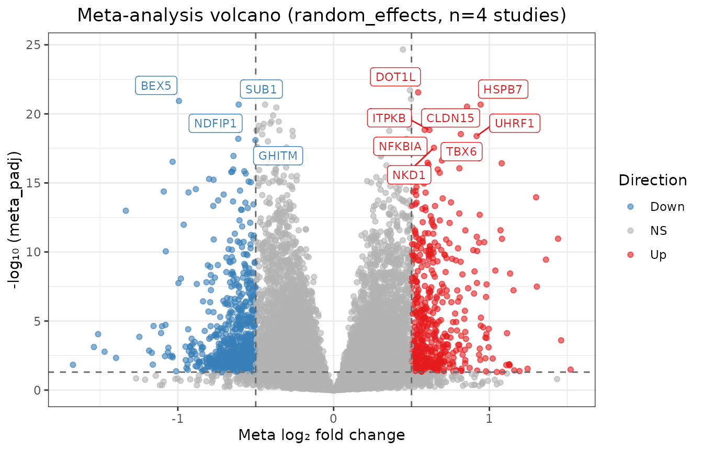
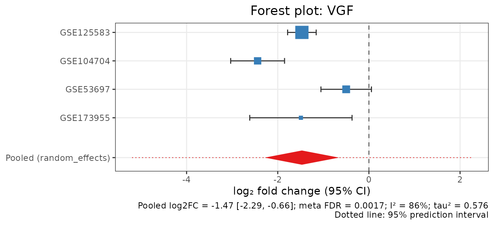

# Getting started with metaXpress

metaXpress combines bulk RNA-seq differential expression (DE) results
from several independent studies into one gene-level meta-analysis.
Every code chunk in this vignette runs on **real public data** when the
vignette is built.

The workflow has three steps:

1.  **Per-study DE.**
    [`mx_de()`](https://mdjubayerhossain.com/metaXpress/reference/mx_de.md)
    runs DESeq2, edgeR or limma-voom separately in each study, from raw
    counts.
2.  **Meta-analysis.**
    [`mx_meta()`](https://mdjubayerhossain.com/metaXpress/reference/mx_meta.md)
    pools the per-study log2 fold changes (random effects by default) or
    combines p-values.
3.  **Interpretation.** Heterogeneity, robustness, visualisation and
    pathway analysis.

``` r

library(metaXpress)
```

## 1. Per-study differential expression

[`mx_de()`](https://mdjubayerhossain.com/metaXpress/reference/mx_de.md)
takes a `metaXpressStudy`, which is a `SummarizedExperiment` with raw
counts and a `condition` column. Any `SummarizedExperiment` converts
with
[`mx_from_se()`](https://mdjubayerhossain.com/metaXpress/reference/mx_from_se.md).

The example uses the airway smooth-muscle experiment of Himes et
al. (2014; GEO
[GSE52778](https://www.ncbi.nlm.nih.gov/geo/query/acc.cgi?acc=GSE52778)):
4 donors, each treated with dexamethasone or left untreated.

``` r

data("airway", package = "airway")
study <- mx_from_se(airway, condition_col = "dex", accession = "GSE52778")
study <- study[rowSums(SummarizedExperiment::assay(study)) >= 10, ]

# Adjust for donor (paired design); fold changes are trt / untrt
study <- mx_de(study, formula = ~ cell + condition,
               contrast = c("trt", "untrt"))
de <- study@de_result
head(de[order(de$padj), c("gene_id", "log2FC", "lfcSE", "stat", "padj")])
#>               gene_id   log2FC     lfcSE     stat          padj
#> 8109  ENSG00000152583 4.574967 0.1842414 24.83137 7.412355e-132
#> 9865  ENSG00000165995 3.291099 0.1330527 24.73530 4.024187e-131
#> 4359  ENSG00000120129 2.947850 0.1218764 24.18720 1.823540e-125
#> 2214  ENSG00000101347 3.767022 0.1559919 24.14882 3.463342e-125
#> 13405 ENSG00000189221 3.353655 0.1421810 23.58722 1.879910e-119
#> 14808 ENSG00000211445 3.730439 0.1663984 22.41872 7.768964e-108
```

Every DE engine returns the same columns. `log2FC` and `lfcSE` are on
the log2 scale, `stat` is a signed z-score, and `n_case`/`n_control`
record the group sizes used for weighting. Shrunken fold changes
(`shrink = "apeglm"`) are added as a separate column, because
inverse-variance meta-analysis needs the unshrunken estimate together
with its standard error.

## 2. Meta-analysis of four Alzheimer’s disease cohorts

The package ships per-study DESeq2 results from four **independent**
Alzheimer’s disease (AD) vs control post-mortem brain cohorts. All four
were quantified by the same NCBI GEO RNA-seq pipeline, so alignment,
annotation and counting are identical across them. The script that
rebuilds the file from GEO is
`system.file("scripts", "make_ad_brain_extdata.R", package = "metaXpress")`.

``` r

ad <- readRDS(system.file("extdata", "ad_brain_de.rds",
                          package = "metaXpress"))
ad$studies
#>   accession                region n_AD n_control n_genes n_DEG_fdr05
#> 1 GSE125583        Fusiform gyrus  218        70   16126       10164
#> 2 GSE104704 Lateral temporal lobe   12        10   15930        1670
#> 3  GSE53697      Dorsolateral PFC    6         6   16029           1
#> 4 GSE173955           Hippocampus    8        10   15905        4149
#>            formula
#> 1 ~sex + condition
#> 2       ~condition
#> 3       ~condition
#> 4       ~condition
de_results <- ad$de_results
```

### Check that the studies agree in direction

Before pooling, make sure that every study encodes AD vs control in the
same orientation. A negative correlation would mean a flipped contrast.

``` r

mx_study_concordance(de_results)
#>     study_1   study_2 n_genes correlation sign_agreement             flag
#> 1 GSE125583 GSE104704   10096  0.75221718      0.8502377               ok
#> 2 GSE125583  GSE53697    9841  0.09469926      0.5314501 weak concordance
#> 3 GSE125583 GSE173955   10722  0.80043218      0.8740907               ok
#> 4 GSE104704  GSE53697    1654  0.38697724      0.6813785               ok
#> 5 GSE104704 GSE173955    5062  0.67807809      0.8609245               ok
#> 6  GSE53697 GSE173955    4078  0.29992966      0.6066699               ok
```

The fold changes of three cohorts correlate strongly (r = 0.68 to 0.80).
The small dorsolateral prefrontal cortex study (GSE53697, 6 vs 6) has
only one significant gene of its own, so its concordance is weak but not
negative.

### Pool the effects

``` r

res <- mx_meta(de_results, method = "random_effects", tau_method = "REML")
res
#> metaXpressResult
#>   Method    : random_effects 
#>   Studies   : 4 
#>   Genes     : 16290 
#>   Sig genes : 7491 (meta_padj <= 0.05)
mt  <- res@meta_table
sig <- mt[mt$meta_padj <= 0.05, ]
nrow(sig)
#> [1] 7491
head(mt[order(mt$meta_pvalue),
        c("gene_id", "meta_log2FC", "ci_lower", "ci_upper",
          "pi_lower", "pi_upper", "meta_padj", "i_squared")], 10)
#>       gene_id meta_log2FC   ci_lower   ci_upper   pi_lower   pi_upper
#> 7674    EHMT1   0.4451290  0.3679108  0.5223471  0.2756141  0.6146438
#> 3486   NDUFB5  -0.4725524 -0.5587443 -0.3863605 -0.6617669 -0.2833379
#> 6680    IKBKB   0.4901355  0.3993599  0.5809111  0.2908585  0.6894125
#> 13287   DOT1L   0.5425005  0.4414538  0.6435472 -0.1125730  1.1975740
#> 6201    LRCH4   0.4970347  0.4033509  0.5907185  0.2913733  0.7026960
#> 15690    BEX5  -0.9928233 -1.1808633 -0.8047833 -1.4056221 -0.5800245
#> 161     HSPB7   0.9433530  0.7632374  1.1234686  0.5479504  1.3387556
#> 9263   COPS7A  -0.4399933 -0.5240303 -0.3559563 -0.6244773 -0.2555092
#> 4255     SUB1  -0.6091167 -0.7255770 -0.4926564 -0.8647787 -0.3534547
#> 6224   CLDN15   0.8559815  0.6916133  1.0203498  0.4951486  1.2168145
#>          meta_padj i_squared
#> 7674  2.178525e-25  55.56881
#> 3486  5.061157e-23  28.43886
#> 6680  1.947134e-22  39.57025
#> 13287 2.766083e-22   0.00000
#> 6201  8.206771e-22  56.82003
#> 15690 1.156312e-21  41.02107
#> 161   2.117688e-21   0.00000
#> 9263  2.117688e-21  27.71732
#> 4255  2.117688e-21  16.83430
#> 6224  3.007809e-21   0.00000
```

For every gene the table reports:

- the pooled log2 fold change with its 95% confidence interval;
- tau² and I², which measure between-study heterogeneity;
- the 95% **prediction interval** (`pi_lower`, `pi_upper`), the range in
  which the effect in a new cohort is expected to fall.

When the prediction interval excludes zero, the effect is reproducible
across settings and not only on average.

``` r

mx_volcano(res, padj_threshold = 0.05, lfc_threshold = 0.5, label_top = 12)
```



### Established AD genes

The neurosecretory protein VGF and the astrocyte marker GFAP are among
the most replicated AD brain changes:

``` r

mx_forest("VGF", de_results, res)
```



``` r

mx_forest("GFAP", de_results, res)
```


VGF is down-regulated in every cohort, but its I² is high and its
prediction interval crosses zero: the size of the loss varies by brain
region. GFAP is homogeneous (I² = 0) and its prediction interval
excludes zero.

### How robust is the signature?

[`mx_sensitivity()`](https://mdjubayerhossain.com/metaXpress/reference/mx_sensitivity.md)
repeats the analysis once without each study in turn.

``` r

loo <- mx_sensitivity(de_results, method = "random_effects")
vapply(loo, function(r) sum(r@meta_table$meta_padj <= 0.05), integer(1))
#> GSE125583 GSE104704  GSE53697 GSE173955 
#>      1550      5541      8123      6256
rob <- attr(loo, "robustness")
table(robust = rob$frac_loo_sig[rob$full_padj <= 0.05] == 1)
#> robust
#> FALSE  TRUE 
#>  6252  1239
```

Dropping the large fusiform-gyrus cohort (GSE125583, n = 288) removes
most of the significant genes. Report the subset that survives every
omission as the robust core signature.

## 3. Pathways

GSEA ranks genes by the signed meta-analysis z-score (fgsea, MSigDB
Hallmarks):

``` r

res <- mx_pathway_meta(res, db = "Hallmarks")
head(res@pathway_result[, c("pathway_id", "NES", "padj")], 8)
#>                            pathway_id       NES         padj
#> 36 HALLMARK_OXIDATIVE_PHOSPHORYLATION -3.077706 4.911417e-31
#> 32            HALLMARK_MYC_TARGETS_V1 -1.991422 1.638455e-06
#> 45   HALLMARK_TNFA_SIGNALING_VIA_NFKB  1.687966 1.134809e-03
#> 24   HALLMARK_IL6_JAK_STAT3_SIGNALING  1.835387 2.403652e-03
#> 37               HALLMARK_P53_PATHWAY  1.569513 3.566265e-03
#> 25     HALLMARK_INFLAMMATORY_RESPONSE  1.588698 4.989763e-03
#> 30           HALLMARK_MITOTIC_SPINDLE  1.510185 7.988942e-03
#> 13               HALLMARK_E2F_TARGETS  1.440066 1.429704e-02
```

Oxidative phosphorylation is down-regulated, and inflammatory, TNF/NF-kB
and IL6/JAK/STAT3 signalling are up-regulated. This matches the
mitochondrial and neuroinflammatory components of AD pathology.

## Next steps

- [`vignette("case_study", package = "metaXpress")`](https://mdjubayerhossain.com/metaXpress/articles/case_study.md):
  the full AD analysis, covering method choice, heterogeneity, the
  Hartung-Knapp adjustment, cross-study pathway meta-analysis and
  reporting.
- [`vignette("full_workflow", package = "metaXpress")`](https://mdjubayerhossain.com/metaXpress/articles/full_workflow.md):
  starting from GEO accessions with
  [`mx_fetch_geo()`](https://mdjubayerhossain.com/metaXpress/reference/mx_fetch_geo.md).

``` r

sessionInfo()
#> R version 4.6.1 (2026-06-24)
#> Platform: x86_64-pc-linux-gnu
#> Running under: Ubuntu 24.04.5 LTS
#> 
#> Matrix products: default
#> BLAS:   /usr/lib/x86_64-linux-gnu/openblas-pthread/libblas.so.3 
#> LAPACK: /usr/lib/x86_64-linux-gnu/openblas-pthread/libopenblasp-r0.3.26.so;  LAPACK version 3.12.0
#> 
#> locale:
#>  [1] LC_CTYPE=C.UTF-8       LC_NUMERIC=C           LC_TIME=C.UTF-8       
#>  [4] LC_COLLATE=C.UTF-8     LC_MONETARY=C.UTF-8    LC_MESSAGES=C.UTF-8   
#>  [7] LC_PAPER=C.UTF-8       LC_NAME=C              LC_ADDRESS=C          
#> [10] LC_TELEPHONE=C         LC_MEASUREMENT=C.UTF-8 LC_IDENTIFICATION=C   
#> 
#> time zone: UTC
#> tzcode source: system (glibc)
#> 
#> attached base packages:
#> [1] stats     graphics  grDevices utils     datasets  methods   base     
#> 
#> other attached packages:
#> [1] metaXpress_0.99.1
#> 
#> loaded via a namespace (and not attached):
#>  [1] SummarizedExperiment_1.42.0 fastmatch_1.1-8            
#>  [3] gtable_0.3.6                xfun_0.61                  
#>  [5] bslib_0.12.0                ggplot2_4.0.3              
#>  [7] htmlwidgets_1.6.4           ggrepel_0.9.8              
#>  [9] Biobase_2.72.0              lattice_0.22-9             
#> [11] vctrs_0.7.3                 tools_4.6.1                
#> [13] generics_0.1.4              stats4_4.6.1               
#> [15] parallel_4.6.1              tibble_3.3.1               
#> [17] airway_1.32.0               pkgconfig_2.0.3            
#> [19] Matrix_1.7-5                data.table_1.18.6.1        
#> [21] RColorBrewer_1.1-3          S7_0.2.2                   
#> [23] desc_1.4.3                  S4Vectors_0.50.3           
#> [25] assertthat_0.2.1            lifecycle_1.0.5            
#> [27] compiler_4.6.1              farver_2.1.2               
#> [29] textshaping_1.0.5           fgsea_1.38.0               
#> [31] DESeq2_1.52.0               Seqinfo_1.2.0              
#> [33] codetools_0.2-20            htmltools_0.5.9            
#> [35] sass_0.4.10                 yaml_2.3.12                
#> [37] pillar_1.11.1               pkgdown_2.2.1              
#> [39] jquerylib_0.1.4             BiocParallel_1.46.0        
#> [41] cachem_1.1.0                DelayedArray_0.38.2        
#> [43] abind_1.4-8                 locfit_1.5-9.12            
#> [45] tidyselect_1.2.1            digest_0.6.39              
#> [47] dplyr_1.2.1                 labeling_0.4.3             
#> [49] cowplot_1.2.0               fastmap_1.2.0              
#> [51] grid_4.6.1                  cli_3.6.6                  
#> [53] SparseArray_1.12.3          magrittr_2.0.5             
#> [55] S4Arrays_1.12.1             withr_3.0.3                
#> [57] scales_1.4.0                rmarkdown_2.32             
#> [59] XVector_0.52.0              matrixStats_1.5.0          
#> [61] otel_0.2.0                  ragg_1.5.2                 
#> [63] evaluate_1.0.5              knitr_1.52                 
#> [65] GenomicRanges_1.64.0        IRanges_2.46.0             
#> [67] msigdbr_26.1.1              rlang_1.3.0                
#> [69] Rcpp_1.1.2                  glue_1.8.1                 
#> [71] BiocGenerics_0.58.1         jsonlite_2.0.0             
#> [73] R6_2.6.1                    MatrixGenerics_1.24.0      
#> [75] systemfonts_1.3.2           fs_2.1.0
```
