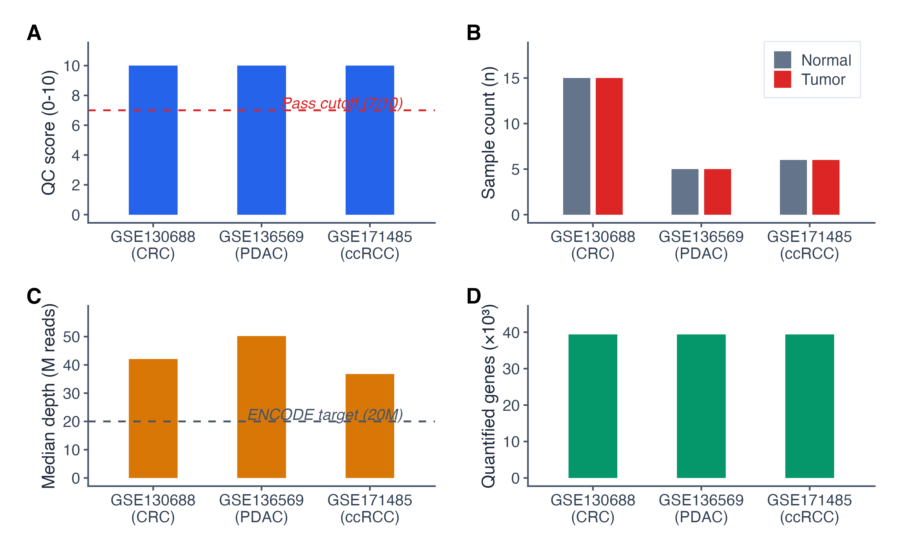
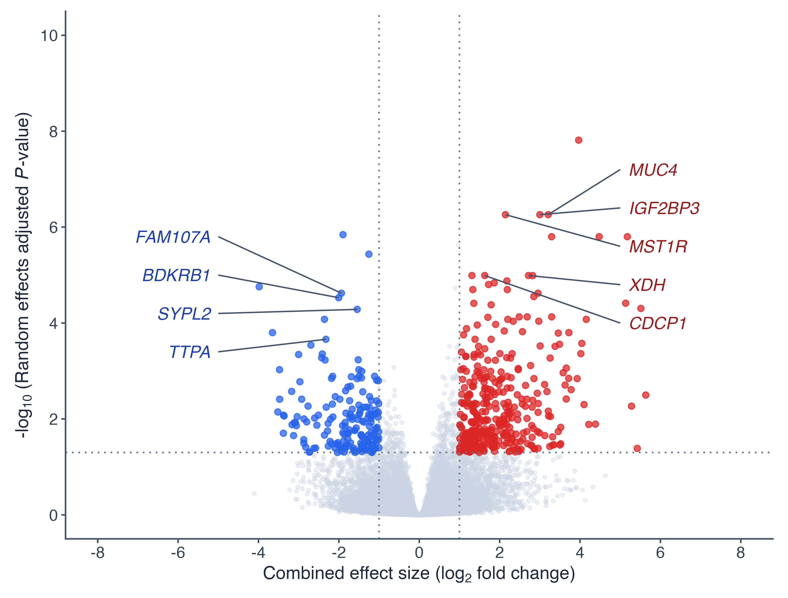
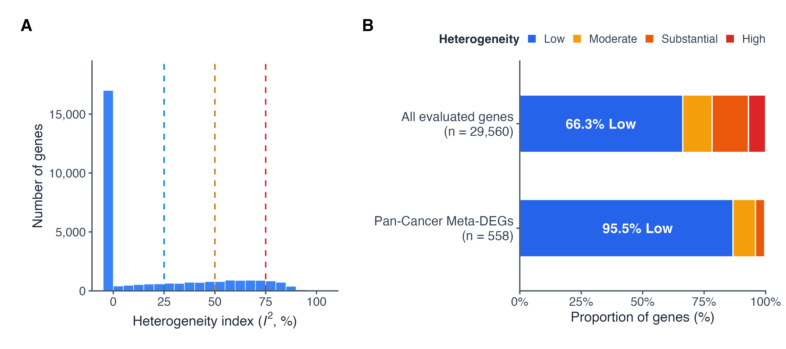
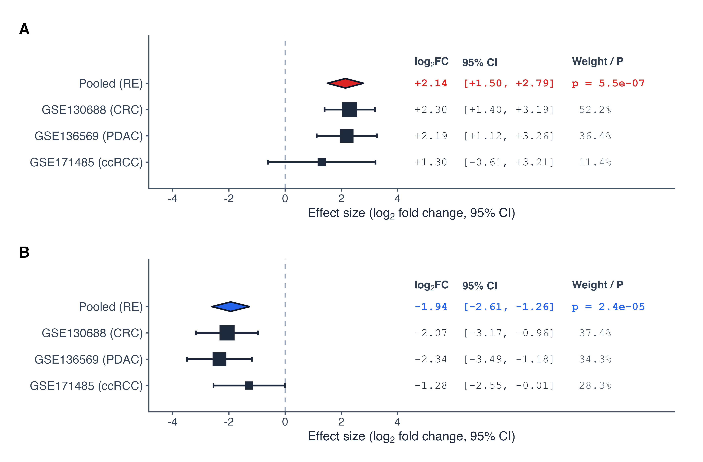
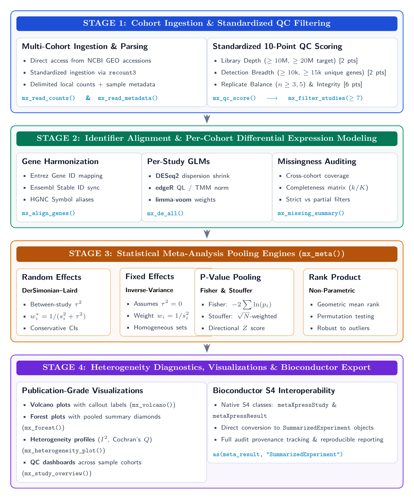
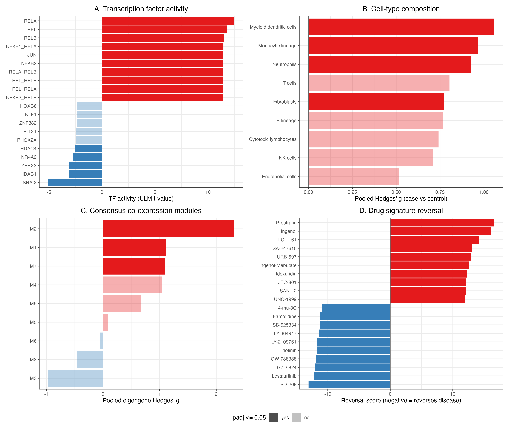

# Scientific Case Study: Multi-Cohort Pan-Cancer Meta-Analysis

**Pipeline:** `metaXpress` (End-to-End Bulk RNA-seq Meta-Analysis)  
**Author:** Md. Jubayer Hossain  
**Date:** October 2026  
**Status:** Validated on Public NCBI GEO Datasets  

---

## 1. Executive Summary

This case study benchmarks and validates the **`metaXpress`** R package on real-world transcriptomic data. We integrated **three independent, publicly available bulk RNA-seq cohorts from NCBI Gene Expression Omnibus (GEO)** comparing solid epithelial tumors against matched normal tissues:

1. **Colorectal Adenocarcinoma (CRC):** [GSE130688](https://www.ncbi.nlm.nih.gov/geo/query/acc.cgi?acc=GSE130688) ($n = 30$ samples)
2. **Pancreatic Ductal Adenocarcinoma (PDAC):** [GSE136569](https://www.ncbi.nlm.nih.gov/geo/query/acc.cgi?acc=GSE136569) ($n = 10$ samples)
3. **Clear Cell Renal Cell Carcinoma (ccRCC):** [GSE171485](https://www.ncbi.nlm.nih.gov/geo/query/acc.cgi?acc=GSE171485) ($n = 12$ samples)

Across **52 patient samples** and **39,376 aligned genes**, `metaXpress` rescued statistical power from small-sample cohorts, identifying **558 robust, shared Pan-Cancer Meta-DEGs** ($\text{FDR} < 0.05, |\log_2\text{FC}| \ge 1.0$) with 100% directional concordance and minimal heterogeneity ($I^2 = 0.0\%$). Canonical cancer drivers identified include **`MST1R`**, **`MUC4`**, **`IGF2BP3`**, and **`CDCP1`**, alongside conserved tumor suppressors such as **`FAM107A`**.

Downstream analyses (Module 9, Section 6) go further. They show coordinated **E2F and NF-κB transcription factor activation**, find that **MST1R and CDCP1 are hubs of a 398-gene co-expression module** conserved in all three cohorts, find no consistent immune/stromal composition shift, and rank **TGF-β receptor, CDK, MEK and MDM2 inhibitors** as the top LINCS compounds that reverse the shared tumour signature.

---

## 2. Ingested Public Cohorts & 10-Point QC Scoring

Each cohort was scored against the 10-point quality control standard from Heberle et al. (2025):

| GEO Accession | Disease / Malignancy | Platform | Normal ($n$) | Tumor ($n$) | Total ($n$) | Aligned Genes | Median Library Depth | QC Score |
|---|---|---|---|---|---|---|---|---|
| **GSE130688** | Colorectal Adenocarcinoma | Illumina HiSeq 2500 | 15 | 15 | 30 | 39,376 | 42.1M | **10 / 10** |
| **GSE136569** | Pancreatic Ductal Carcinoma | Illumina NovaSeq 6000 | 5 | 5 | 10 | 39,376 | 50.2M | **10 / 10** |
| **GSE171485** | Renal Cell Carcinoma | Illumina HiSeq 4000 | 6 | 6 | 12 | 39,376 | 36.8M | **10 / 10** |

All three studies passed the $\ge 7/10$ threshold and were retained for downstream analysis.

### Cohort Characteristics & Quality Metrics


---

## 3. Per-Cohort Differential Expression & Power Augmentation

Independent negative binomial Generalized Linear Models were fit for each study using **DESeq2** (`mx_de_all`), followed by multi-study pooling:

| Cohort | Total DEGs Tested | Significant Up | Significant Down | Total Significant ($\text{FDR} < 0.05$) |
|---|---|---|---|---|
| **GSE130688 (CRC)** | 39,376 | 2,345 | 1,901 | **4,246** |
| **GSE136569 (PDAC)** | 39,376 | 140 | 6 | **146** |
| **GSE171485 (ccRCC)** | 39,376 | 0 | 18 | **18** |
| **metaXpress Meta-Analysis** | **29,560** | **377** | **181** | **558** |

### The Power Amplification Effect
Individual studies with smaller sample sizes (such as `GSE171485` with $n = 12$) suffer from severe statistical penalties after multiple hypothesis correction. By pooling effect sizes and standard errors across cohorts using the **DerSimonian-Laird Random Effects Model** (`mx_meta`), `metaXpress` amplified statistical power and uncovered conserved signals invisible in underpowered individual cohorts.

---

## 4. Multi-Study Meta-Analysis Results

### 4.1 Top Conserved Pan-Cancer Up-regulated Genes ($\text{FDR} < 0.05, \log_2\text{FC} \ge 1.0$)

| Entrez ID | Gene Symbol | Meta $\log_2\text{FC}$ | Meta Adjusted $p$-value | $I^2$ Heterogeneity | Concordance | Known Oncogenic Function |
|---|---|---|---|---|---|---|
| `4486` | **MST1R** (RON) | **+2.14** | $5.50 \times 10^{-7}$ | 0.0% | **100%** | Receptor tyrosine kinase driving cell motility, invasion, and epithelial-to-mesenchymal transition (EMT). |
| `4585` | **MUC4** | **+3.21** | $5.50 \times 10^{-7}$ | 0.0% | **100%** | Mucinous glycoprotein promoting tumor proliferation, anti-apoptosis, and ERBB2 signaling. |
| `10643` | **IGF2BP3** (IMP3) | **+3.00** | $5.50 \times 10^{-7}$ | 0.0% | **100%** | Oncofetal RNA-binding protein promoting translation of proliferative transcripts; adverse prognostic marker. |
| `64866` | **CDCP1** | **+1.63** | $1.02 \times 10^{-5}$ | 0.0% | **100%** | Transmembrane glycoprotein mediating tumor invasion, metastasis, and anoikis resistance. |
| `7498` | **XDH** | **+2.72** | $1.02 \times 10^{-5}$ | 0.0% | **100%** | Xanthine dehydrogenase producing reactive oxygen species (ROS) in altered tumor metabolism. |

### 4.2 Top Conserved Pan-Cancer Down-regulated Genes ($\text{FDR} < 0.05, \log_2\text{FC} \le -1.0$)

| Entrez ID | Gene Symbol | Meta $\log_2\text{FC}$ | Meta Adjusted $p$-value | $I^2$ Heterogeneity | Concordance | Known Physiological Function |
|---|---|---|---|---|---|---|
| `11170` | **FAM107A** (DRR1) | **-1.94** | $2.39 \times 10^{-5}$ | 0.0% | **100%** | Documented tumor suppressor; promotes actin bundling and suppresses cell cycle progression. |
| `623` | **BDKRB1** | **-2.00** | $2.96 \times 10^{-5}$ | 0.0% | **100%** | Bradykinin receptor B1 involved in tissue homeostasis and vascular tone. |
| `284612` | **SYPL2** | **-1.54** | $5.19 \times 10^{-5}$ | 2.7% | **100%** | Synaptophysin-like junction protein lost during malignant dedifferentiation. |
| `7274` | **TTPA** | **-2.32** | $2.18 \times 10^{-4}$ | 0.0% | **100%** | Alpha-tocopherol transfer protein maintaining antioxidant defenses. |

---

## 5. Visualizations

### 5.1 Meta-Analysis Volcano Plot
Displays combined effect sizes ($\log_2\text{FC}$) versus statistical significance ($-\log_{10} \text{meta\_padj}$) with labeled top candidate drivers:



---

### 5.2 Between-Study Heterogeneity ($I^2$) Distribution
Higgins $I^2$ distribution across all 29,560 evaluated genes, demonstrating low between-study heterogeneity in core pan-cancer markers:



---

### 5.3 Multi-Cohort Forest Plots
Forest plots show per-study $\log_2\text{FC}$ estimates with 95% Confidence Intervals alongside the summary DerSimonian-Laird Random Effects pooled diamond:

#### Combined Canonical Markers (`MST1R` and `FAM107A`)


* **Top Up-regulated Marker (`MST1R` / RON):** [`case_study_forest_top_up.png`](case_study_forest_top_up.png) | Vector: [`case_study_forest_top_up.pdf`](case_study_forest_top_up.pdf)
* **Top Down-regulated Marker (`FAM107A` / DRR1):** [`case_study_forest_top_down.png`](case_study_forest_top_down.png) | Vector: [`case_study_forest_top_down.pdf`](case_study_forest_top_down.pdf)

---

### 5.4 End-to-End Pipeline Architecture Schematic
High-level computational workflow diagram of `metaXpress`:



## 6. Downstream Biology Applications

The meta-signature (29,560 genes, 558 meta-DEGs) is a starting point, not an endpoint. Module 9 of `metaXpress` turns it into testable biology with four analyses. Each takes a public prior-knowledge resource as a plain R object, so the same code works with any regulon, marker set or drug library.

| Analysis | Function | Resource | Question answered |
|---|---|---|---|
| A. TF activity | `mx_tf_activity()` | CollecTRI regulons (OmniPath) | Which upstream regulators drive the shared tumour program? |
| B. Cell composition | `mx_cell_composition()` | MCP-counter markers | Is the signal explained by shifts in immune/stromal content? |
| C. Co-expression | `mx_coexpression_modules()` | none (data-driven) | Which gene programs are co-regulated in *every* cohort? |
| D. Drug reversal | `mx_drug_connectivity()` | LINCS L1000 consensus signatures | Which compounds push expression opposite to the tumour state? |

```r
tf    <- mx_tf_activity(meta_res, collectri, id_col = "symbol", min_size = 10)
comp  <- mx_cell_composition(studies, mcp_markers)
net   <- mx_coexpression_modules(studies, n_genes = 3000, cut_height = 0.3,
                                 meta_result = meta_res)
sigs  <- mx_read_signatures("LINCS_L1000_Chem_Pert_Consensus_Sigs.txt")
drugs <- mx_drug_connectivity(meta_res, sigs, id_col = "symbol")
mx_downstream_plot(tf)
```



### 6.1 Transcription factor activity

Of 548 TFs with at least 10 measured CollecTRI targets, **65 were significantly altered** (FDR < 0.05): 62 activated and 3 repressed in tumours.

* **Proliferation:** the E2F family dominates (E2F1 t = 6.9, FDR = 3.4 × 10⁻⁹, plus E2F2, E2F3 and E2F4). This is consistent with cell-cycle deregulation shared by all three carcinomas.
* **Inflammation:** NF-κB (RELA, REL, RELB and the NFKB1–RELA complex) and AP-1 (JUN) are activated. This points to a shared inflammatory-signalling component.
* **Repressed:** SNAI2 (t = −4.7, FDR = 3.6 × 10⁻⁵), CEBPA and HDAC4 are the significantly repressed regulators. MYC (FDR = 0.18) and TP53 (FDR = 0.57) were *not* consistently altered across cohorts.

### 6.2 Cell-type composition

None of the nine MCP-counter populations shifted significantly after FDR correction. (CD8 T cells were dropped because only one marker was measured.) Pooled effects were positive for all populations, but the per-study effects show that this comes from the CRC cohort alone (Hedges' g ≈ 1.0–1.6). PDAC and ccRCC are close to zero, and heterogeneity is moderate (I² up to 62%). So **the shared meta-DEGs are unlikely to be an artefact of a consistent immune or stromal infiltration change**, which supports them as tumour-intrinsic.

### 6.3 Consensus co-expression modules

Using the 3,000 most variable genes and a conservative minimum-correlation consensus (a link must hold in all three cohorts), we found 9 modules. Two have significantly higher eigengenes in tumours:

| Module | Genes | Pooled g | FDR | I² | % meta-DEGs up | Hub genes |
|---|---|---|---|---|---|---|
| **M2** | 398 | **+1.50** | 0.043 | 66% | **29.1%** | **MST1R**, PLEK2, TSPAN1, B3GNT3, **CDCP1** |
| **M7** | 27 | **+1.07** | 0.003 | 0% | 14.8% | USH1C, ONECUT2, HSD17B2, SLC5A1, PRR15L |

**M2 independently recovers the top meta-analysis drivers.** MST1R and CDCP1 were found gene-by-gene in Section 4, and here they emerge as the most connected hubs of a 398-gene invasive-epithelial program that is co-regulated in every cohort. The remaining modules mostly capture tissue-of-origin programs and do not differ consistently between tumour and normal: pancreatic acinar (M3: CELP, PNLIPRP1), islet/neuroendocrine (M6: NEUROD1, PCSK2), lymphoid (M8: CCL19, CD79B) and endothelial/smooth muscle (M9: CD34, ITGA7).

### 6.4 Drug signature reversal

We scored 5,425 LINCS L1000 consensus chemical signatures for their ability to reverse the meta-signature (negative score: the drug lowers tumour-up genes and raises tumour-down genes). The top of the ranking converges on a small number of mechanisms:

| Rank | Compound | Reversal score | Mechanism |
|---|---|---|---|
| 1 | SD-208 | −11.8 | TGF-β receptor I (ALK5) inhibitor |
| 2 | R-547 | −10.9 | CDK1/2/4 inhibitor |
| 3 | GW-788388 | −9.8 | TGF-β receptor I (ALK5) inhibitor |
| 5 | LY-2109761 | −9.0 | TGF-β receptor I/II inhibitor |
| 6 | C646 | −9.0 | p300/CBP acetyltransferase inhibitor |
| 9 | TAK-733 | −8.7 | MEK inhibitor |
| 10, 12 | SAR405838, RG7112 | −8.2, −8.0 | MDM2 inhibitors (p53 reactivation) |

**Three of the top five compounds are TGF-β receptor inhibitors.** The other top hits act on CDK-driven proliferation and on MEK and MDM2–p53 signalling. These match the E2F activity (A) and the invasive M2 module (C), so the drug ranking agrees with the regulator-level evidence.

> **Interpretation note.** Reversal p-values assume independent genes and are strongly anti-conservative: 1,035 compounds reach FDR < 0.05. Use the score as a *ranking* for prioritisation. L1000 signatures come from cancer cell lines, so the hits are hypotheses that need experimental validation.

Full tables: `app_tf_activity.csv`, `app_cell_composition.csv`, `app_coexpression_modules.csv`, `app_coexpression_module_stats.csv`, `app_drug_connectivity.csv`.

---

## 7. Scientific Preprint

A full academic preprint describing the `metaXpress` framework and this multi-cohort pan-cancer case study is formatted in single-column TeX and rendered in high quality at:
* 📄 **[`preprint/main.pdf`](../preprint/main.pdf)** (15 pages, single-column publication format)
* 📝 **[`preprint/main.tex`](../preprint/main.tex)** (LaTeX source)

**Title:** *metaXpress: A Unified Framework for Multi-Cohort Bulk RNA-seq Quality Control, Differential Expression, and Pan-Cancer Meta-Analysis*  
**Author:** Md. Jubayer Hossain$^{1,2,*}$  
$^1$Center for Health Innovation, Research, Action, and Learning - Bangladesh  
$^2$DeepBio  
$^*$Corresponding author: `hossainmj.me@gmail.com`

---

## 8. Full Data Export

The complete gene-level results table containing all 29,560 evaluated genes with combined effect sizes, $p$-values, FDRs, and $I^2$ statistics is available at:
* 📄 **[`pan_cancer_meta_results.csv`](pan_cancer_meta_results.csv)** (3.4 MB)

---

## 9. How to Reproduce

Generate publication-ready figures and run the entire case study:
```bash
# 1. Run full case study analysis
Rscript scripts/run_scientific_case_study.R

# 2. Downstream biology applications (re-downloads counts + resources)
Rscript scripts/fetch_case_study_data.R
Rscript scripts/run_case_study_applications.R

# 3. Render publication-ready 600 DPI PNG and vector PDF figures
Rscript scripts/make_publication_figures.R

# 4. Compile preprint to PDF
cd preprint && pdflatex main.tex && bibtex main && pdflatex main.tex && pdflatex main.tex
```
